# Cloudline AI-CLS6 fan controller

A stand-alone speed controller for the **AC Infinity Cloudline AI-CLS6**
(Cloudline S6) EC inline fan. It uses an **Arduino Nano** and an **AITRIP
1.3″ OLED module with a built-in EC11 rotary encoder**, plugs into the fan's
4-pin Molex control lead in place of the stock controller, and runs entirely
from the fan's own 10 V supply.

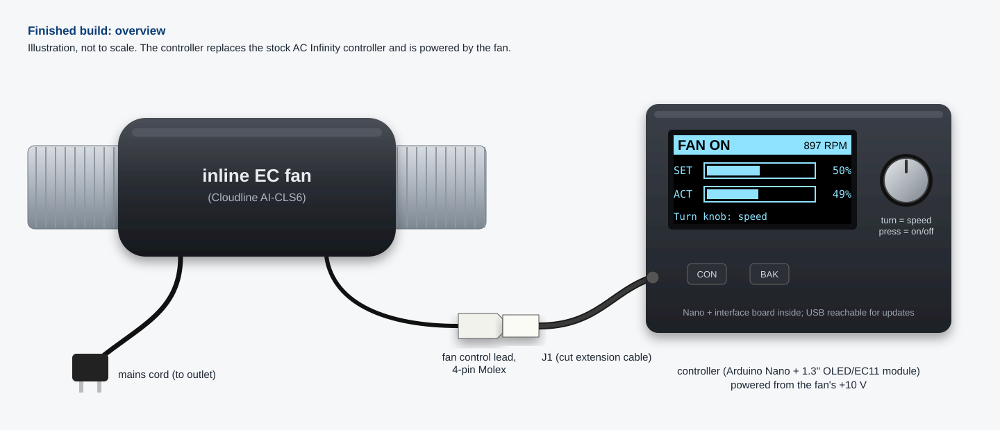

| Fan off | Fan running (calibrated) |
|---|---|
| 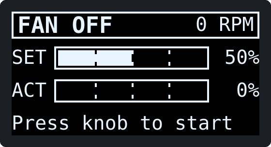 | 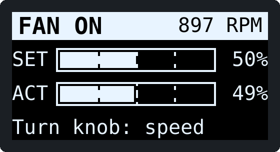 |

## What it does

- **Turn the knob** to set the speed from 0 to 100 %: 1 % per click, or 5 %
  per click when you spin it quickly.
- **Press the knob** to switch the fan on or off.
- **The fan is always off at power-up.** A resistor guarantees this in
  hardware before the Arduino even starts, and the firmware starts OFF.
- **The speed setting is kept while the controller has power.** Off and on
  again returns to the same speed. After a power cut it starts OFF at 50 %.
  Nothing is stored permanently.
- **The display shows:**
  - ON/OFF status in the title bar, which turns solid while the fan is on;
  - **SET**: the speed you asked for, as a bar and a percentage;
  - **ACT**: the measured speed from the fan's tachometer, as a bar and a
    percentage of the fan's calibrated top speed;
  - the measured **RPM**.
- **Power:** taken from the fan's +10 V through a resettable fuse,
  reverse-polarity diode, surge clamp and filtering. The controller draws
  about 35–60 mA.
- **Safety nets:** a watchdog stops the fan and restarts the controller if
  the program ever hangs; a "NO TACH / STALLED" warning appears if the fan is
  told to run but no speed pulses arrive.

> ⚠️ **Read before you build.** AC Infinity does not publish the electrical
> details of the control port. The pin functions and signal levels in this
> project come from other builders' reports, and **whether the 4-pin port
> carries a tachometer signal at all is unconfirmed**. The
> [pre-connection verification](#pre-connection-verification) below takes
> about 20 minutes with a multimeter and tells you whether your fan matches.
> Without a tach signal everything works except the ACT bar and RPM.
> [VERIFICATION.md](VERIFICATION.md) lists exactly what has and has not been
> verified.

## Contents

1. [Documents in this repository](#documents-in-this-repository)
2. [Bill of materials](#bill-of-materials)
3. [Tools](#tools)
4. [Software setup](#software-setup)
5. [Pre-connection verification](#pre-connection-verification)
6. [Step-by-step build](#step-by-step-build)
7. [First power-up on the fan](#first-power-up-on-the-fan)
8. [Normal operation](#normal-operation)
9. [Troubleshooting](#troubleshooting)
10. [Development and tests](#development-and-tests)
11. [Sources](#sources)

---

## Documents in this repository

| Document | Contents |
|---|---|
| [PINOUT.md](PINOUT.md) | Every pin of every part, power rails, point-to-point wiring list |
| [hardware/schematic.svg](hardware/schematic.svg) ([PNG](hardware/schematic.png)) | Full schematic, every part labelled with reference and value |
| [hardware/wiring.svg](hardware/wiring.svg) ([PNG](hardware/wiring.png)) | Physical wiring view with suggested wire colours, for people who don't read schematics |
| [hardware/bom.csv](hardware/bom.csv) | Parts list with part numbers and prices |
| [FAQ.md](FAQ.md) | The questions builders ask: USB + fan power, PWM frequency, other fans, warranty, other boards… |
| [BENCH_TEST.md](BENCH_TEST.md) | Manual test of every requirement, first with a dummy load, then with the fan |
| [VERIFICATION.md](VERIFICATION.md) | Requirements traceability, electrical calculations, pin cross-check, what is verified versus assumed, known limitations, review findings |
| [CHANGELOG.md](CHANGELOG.md) | Changes |
| [firmware/](firmware/) | Arduino sketch. Every setting is in [`config.h`](firmware/cloudline_controller/config.h) |
| [test/](test/) | Host unit tests and simulations ([how to run](test/README.md)) |
| [sim/](sim/) | Wokwi simulator files ([what can and cannot be simulated](sim/README.md)) |

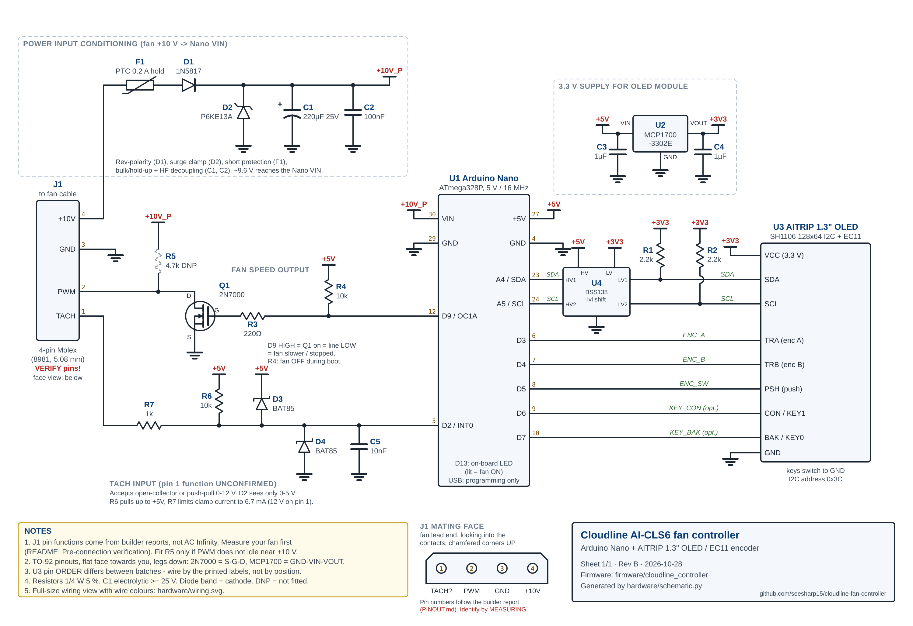

---

## Bill of materials

Prices are approximate (USD, 2026) for single quantities. The full list with
manufacturer part numbers is in [hardware/bom.csv](hardware/bom.csv). Any
part with the same value and rating works; the part numbers are examples.

| Ref | Qty | Part | Value / rating | Example part number | ≈ Cost |
|---|---|---|---|---|---|
| U1 | 1 | Arduino Nano | ATmega328P, 5 V, 16 MHz (CH340 clone is fine) | Arduino A000005, or ELEGOO Nano V3.0 | $8 (clone) |
| U3 | 1 | 1.3″ OLED + EC11 module | SH1106, 128×64, I²C 0x3C, 3.3 V | AITRIP 1.3″ OLED with EC11 (Amazon ASIN B0F87DZ51P) | $10 |
| U2 | 1 | 3.3 V LDO regulator | 250 mA, V<sub>in</sub> ≤ 6 V, TO-92 | Microchip MCP1700-3302E/TO | $0.45 |
| Q1 | 1 | N-channel MOSFET | 60 V, 200 mA, logic-level, TO-92 | onsemi 2N7000TA | $0.30 |
| D1 | 1 | Schottky diode | 1 A, 20 V | 1N5817 | $0.20 |
| D2 | 1 | TVS diode, unidirectional | V<sub>RWM</sub> 11.1 V, 600 W | Littelfuse P6KE13A (P6KE15A if your fan measures > 10.8 V) | $0.45 |
| D3, D4 | 2 | Small Schottky diode | 30 V, 200 mA | BAT85 | $0.30 |
| F1 | 1 | Resettable PTC fuse | 0.2 A hold, 0.4 A trip | Bourns MF-R020 | $0.35 |
| C1 | 1 | Electrolytic capacitor | 220 µF, 25 V | Panasonic EEU-FR1E221 | $0.40 |
| C2 | 1 | Ceramic capacitor | 100 nF, 50 V | KEMET C320C104K5R5TA | $0.25 |
| C3, C4 | 2 | Ceramic capacitor | 1 µF, 25–50 V | TDK FG28X7R1H105KRT06 | $0.60 |
| C5 | 1 | Ceramic capacitor | 10 nF, 50 V | KEMET C315C103K5R5TA | $0.25 |
| R1, R2 | 2 | Resistor ¼ W 5 % | 4.7 kΩ | Yageo CFR-25JB-52-4K7 | $0.20 |
| R3 | 1 | Resistor ¼ W 5 % | 220 Ω | Yageo CFR-25JB-52-220R | $0.10 |
| R4, R6 | 2 | Resistor ¼ W 5 % | 10 kΩ | Yageo CFR-25JB-52-10K | $0.20 |
| R5 | (1) | Resistor ¼ W 5 %, **only if check M3 says so** | 4.7 kΩ | Yageo CFR-25JB-52-4K7 | $0.10 |
| R7 | 1 | Resistor ¼ W 5 % | 1 kΩ | Yageo CFR-25JB-52-1K0 | $0.10 |
| J1 | 1 | 4-pin PC "Molex" extension cable | male-to-female, 18–20 AWG | StarTech.com LP4POWEXT12 | $4 |
| — | 1 | Perfboard | 5 × 7 cm, 2.54 mm pitch | any | $1 |
| — | 2 | Female header strip (Nano socket) | 1 × 15, 2.54 mm | Sullins PPTC151LFBN-RC | $2 |
| — | 10 | Female-female jumper wires | 20 cm Dupont, for the OLED module | any | $3 |
| — | — | Hook-up wire | 22 AWG stranded (power), 24–26 AWG stranded (signals), several colours | any silicone wire kit | $8 |
| — | — | Heat-shrink tubing | 2–6 mm assortment, 2:1 | any | $6 |
| — | 1 | Enclosure | ABS, about 112 × 62 × 31 mm | Hammond 1591XXSSBK, or 3D-printed | $6 |
| — | 1 | Cable gland | PG7 | any | $0.50 |
| — | 4 | Nylon standoffs and screws | M2.5 or M3 | any | $1 |
| | | | | **Total** | **≈ $55** |

## Tools

| Tool | Notes |
|---|---|
| Temperature-controlled soldering iron | 330–360 °C, small chisel tip |
| Solder | 0.6–0.8 mm rosin-core |
| **Digital multimeter** | Must measure DC volts, resistance, continuity and **diode test**. A frequency (Hz) range is useful for the tach check but not essential. |
| Wire strippers, flush cutters, tweezers | |
| Heat gun or lighter | For heat-shrink |
| **USB cable for the Nano** | Usually **Mini-USB** (some clones use Micro-USB or USB-C). It must be a **data** cable, not charge-only. |
| Computer | Windows, macOS or Linux, with Arduino IDE 2.x |
| 9 V battery with snap lead (or a 9–10 V bench supply with current limit) | For testing the power section before anything touches the fan. Optional but recommended. |
| 220 Ω 1 W resistor, 4.7 kΩ and 10 kΩ ¼ W resistors, 100 Ω ¼ W resistor | For the pre-connection checks (spares from the parts list work) |
| Small drill / step bit, file | For the enclosure window and knob hole |

---

## Software setup

1. **Install the Arduino IDE 2.x** from <https://www.arduino.cc/en/software>
   (2.3.x or newer).
2. **Board support.** Open *Tools → Board → Boards Manager*, search for
   **Arduino AVR Boards**, and install version **1.8.6**. (It is usually
   already installed; just check the version.)
3. **Library.** Open *Tools → Manage Libraries*, search for **U8g2** (by
   oliver), choose version **2.35.30** in the version drop-down, and click
   *Install*. No other library is needed. The pinned versions are listed in
   [firmware/libraries.txt](firmware/libraries.txt).
4. **Open the sketch.** *File → Open* →
   `firmware/cloudline_controller/cloudline_controller.ino`. Four tabs open:
   `cloudline_controller.ino`, `app.cpp`, `config.h`, `display_ui.h`,
   `fan_logic.h`. The folder must stay named `cloudline_controller`.
5. **Select the board.** *Tools → Board → Arduino AVR Boards → Arduino
   Nano*.
6. **USB driver (clone Nanos).** Most clones use a **CH340** USB chip. Plug
   the Nano in and look at *Tools → Port*:
   - A new port appears (`COM3`… on Windows, `/dev/cu.usbserial-…` or
     `/dev/cu.wchusbserial…` on macOS, `/dev/ttyUSB0` on Linux): fine, select it.
   - No new port: install the CH340 driver (**CH341SER**) from the chip maker,
     WCH: <https://www.wch-ic.com/downloads/CH341SER_EXE.html> (Windows) or
     <https://www.wch-ic.com/downloads/CH341SER_MAC_ZIP.html> (macOS), then
     replug. Linux needs no driver. If still nothing, try another USB cable:
     many are charge-only.
7. **Processor setting.** *Tools → Processor* has two choices:
   - **"ATmega328P"**: genuine Nanos and newer clones (Optiboot bootloader,
     uploads at 115200 baud).
   - **"ATmega328P (Old Bootloader)"**: most older and cheap clones
     (uploads at 57600 baud).

   **How to tell:** start with *ATmega328P* and click *Upload* (with any
   sketch, e.g. *File → Examples → 01.Basics → Blink*). If it ends with an
   error like `avrdude: stk500_recv(): programmer is not responding` or
   `not in sync: resp=0x00` after about 10 tries, switch to *Old Bootloader*
   and upload again. Whichever one works is the one you have. The watchdog in
   this firmware is designed to work with both (see
   [FAQ](FAQ.md#what-does-the-watchdog-do-and-is-it-safe-with-the-old-bootloader)).
8. **Compile once** (*Sketch → Verify*). Expected result:

   ```
   Sketch uses 25404 bytes (82%) of program storage space. Maximum is 30720 bytes.
   Global variables use 1276 bytes (62%) of dynamic memory, leaving 772 bytes for local variables. Maximum is 2048 bytes.
   ```

   ("Old Bootloader" shows the same numbers.) Don't upload yet: that is
   build step 5.

Command-line alternative:

```sh
arduino-cli core install arduino:avr@1.8.6
arduino-cli lib install "U8g2@2.35.30"
arduino-cli compile -b arduino:avr:nano firmware/cloudline_controller
arduino-cli upload  -b arduino:avr:nano -p <port> firmware/cloudline_controller
# old bootloader: -b arduino:avr:nano:cpu=atmega328old
```

---

## Pre-connection verification

Do this **before you build anything**, on the fan itself. It confirms the
pin functions, the supply, and the speed signal. You need the multimeter, the
fan plugged into mains, and the resistors listed under Tools. Nothing here
can damage the fan: every test either just measures or goes through a
resistor.

**Setup.** Unplug the stock controller from the fan's control lead. Look
into the lead's 4-pin Molex plug with the two chamfered corners at the top
and number the contacts **1 to 4 from left to right** (picture in
[PINOUT.md §2](PINOUT.md#2-j1-fan-connector-4-pin-molex-pc-peripheral-type-508-mm-pitch)).
The fan may run at full speed while nothing is plugged in. That is expected
and is one of the things being checked. Probe the contacts from the front
with thin probe tips, or plug in the J1 extension cable and probe its loose
end (then follow the wires back to be sure which is which).

Record every reading in a table like the one below; you'll need them later.

| Check | How | Expected | If not → STOP and… |
|---|---|---|---|
| **M1 Supply and ground** | DC volts, black probe on pin 3, red on pin 4 | **+9.5 to +10.5 V** | **Negative reading:** you are numbering from the wrong side; mirror the numbers and repeat. **No pin pair gives 9–11 V:** your fan's port is different (for example a newer USB-C "UIS" port, see [FAQ](FAQ.md#will-this-work-with-other-ac-infinity-fans-or-other-4-pin-fans)). Don't connect. **10.8–12 V:** fit a P6KE15A for D2 instead of P6KE13A. **Over 12 V:** don't connect; the design needs changes. |
| **M2 Supply under load** | Hold a **220 Ω 1 W** resistor across pins 4 and 3 for 5 s and measure pins 4–3 again | Within **0.5 V** of M1 (45 mA load, more than the controller draws) | Drop of more than 1 V: the port can't power the controller. Power the Nano from a separate 9–12 V adapter (FAQ) and leave J1 pin 4 unconnected. |
| **M3 Speed line pull-up** | DC volts, pin 3 (black) to pin 2 (red), nothing else connected | **About the same as M1** (an internal pull-up to the fan's supply) | **Below 1 V or drifting:** the line floats. Fit R5 (4.7 kΩ). **Above M1 + 0.5 V:** don't connect. |
| **M3b Pull-up strength** | Connect a **10 kΩ** resistor from pin 2 to pin 3 and measure pins 2–3 | **1 V or more** (means the internal pull-up is 100 kΩ or less, so the line can be pulled low by Q1 and still rise quickly). Note the value: pull-up R ≈ 10 kΩ × (M3 ÷ reading − 1). | Below 0.1 V: the pull-up is very weak (> 1 MΩ). Fit R5. |
| **M4 Polarity and stop** | Connect pin 2 to pin 3 through a **100 Ω** resistor. Wait 15 s. Remove it. Wait 15 s. | Linked: the fan **slows down and stops** (it may coast for several seconds). Released: it **speeds up to full**. | **Opposite** (linked = full, released = stop): set `FAN_PWM_INVERTED 0` in `config.h` **and** connect R4 from the Q1 gate to GND instead of +5V. **Linked = slow but never stops:** this fan does not stop at 0 %; OFF will mean "minimum speed" ([FAQ](FAQ.md#does-0-or-off-actually-stop-the-fan)). **No change at all:** pin 2 isn't the speed line; recheck the numbering. |
| **M5 Tach pin** | Fan at full speed (pin 2 released). DC volts pin 3 (black) to pin 1 (red). If your meter has Hz, measure that too. Then connect a **10 kΩ** resistor from pin 1 to pin 4 and repeat. Then stop the fan (100 Ω link on pin 2) and repeat. | A tach shows up as a **frequency of roughly 10–200 Hz while running** (or a steady DC reading between 2 and 8 V that changes when the fan stops), at least with the 10 kΩ pull-up connected. Write down the frequency at full speed. | **Steady 0 V, no frequency in any case:** no tach on this port. The controller still works; ACT shows `--%`. **Steady voltage equal to M1 that doesn't change:** not a tach (another supply pin); it is still safe to connect (R7 limits the current) but there will be no RPM. **Above 12 V:** don't connect pin 1; leave R7 unconnected at J1. |
| **M6 No short to mains** | Unplug the fan from mains. Ohms, each pin 1–4 to each mains plug blade | **Open circuit (OL)** on every combination | Any reading: the fan is faulty or the port is not isolated. Do not use it. |

When all checks pass, plug the stock controller back in if you still want to
use the fan, and start the build.

---

## Step-by-step build

Build in this order. Each step ends with a check: **don't continue until the
check passes.** The schematic shows every connection; the
[wiring view](hardware/wiring.png) shows where wires go physically; the
[point-to-point list](PINOUT.md#6-point-to-point-wiring-list) is a checklist.

Soldering basics: heat the pad and the lead together for 2–3 s, feed solder
into the joint (not onto the iron), and stop when it flows into a small
shiny cone. Trim leads after soldering. Diodes: the **band is the cathode**.
The electrolytic capacitor: the **stripe marks the negative** lead. TO-92
parts (Q1, U2): read the flat face, legs down, left to right (PINOUT.md §5).

### Step 1. Verify the fan connector

Do the [pre-connection verification](#pre-connection-verification) M1–M6 and
write down the results. Then prepare **J1**: cut the Molex extension cable in
half, keep the end that plugs into the fan's lead, strip 5 mm from each wire,
and **label each wire with its pin number and function** (tape flags). Put
heat-shrink on the cable end.

✅ **Check before continuing:** with J1 plugged into the fan (fan powered),
J1's labelled "+10V" wire reads the M1 voltage against its "GND" wire. Then
unplug J1 from the fan.

### Step 2. Build the power conditioning

On the perfboard, plan three areas (power on the left, Nano socket in the
middle, fan interface near the J1 entry). Solder:

1. the two 15-pin female headers for the Nano socket, 15.24 mm (6 holes) apart;
2. **F1** (PTC), **D1** (1N5817, band towards the Nano VIN side),
   **D2** (P6KE13A, band to +10V_P, other end to GND),
   **C1** (220 µF, stripe to GND), **C2** (100 nF, close to the socket's VIN
   and GND pins);
3. wires: J1 "+10V" to F1, J1 "GND" to the board's GND line, +10V_P to the
   socket's **VIN** pin (30), GND to the socket's **GND** pins (29 and 4).

Do **not** connect J1's PWM and TACH wires yet. Insulate their ends with
heat-shrink.

✅ **Check before continuing** (nothing powered):
- Diode test across D1, red on the F1 side: **0.15–0.35 V**. Reversed: **OL**.
- Resistance +10V_P to GND: **not below 1 kΩ** (it climbs as C1 charges
  from the meter, which is normal).
- Continuity J1 "GND" to socket pin 29 and pin 4: **beep (< 1 Ω)**.
- Continuity J1 "+10V" to socket pin 30: **no beep** (D1 is in the way).

### Step 3. Test the power section with no Nano

Leave the Nano out of its socket. Connect a 9 V battery (or a bench supply
set to 10.0 V, current limit 100 mA) to J1's +10V and GND wires.

✅ **Check before continuing:**
- Socket VIN (pin 30) to GND: **battery voltage minus 0.2–0.4 V** (about
  8.7 V on a fresh 9 V battery, about 9.7 V on a 10 V supply).
- Supply current, if your supply shows it: **under 1 mA**.
- **Reverse-polarity test:** swap the battery leads. Socket VIN now reads
  **0 V (±0.1 V)**. D1 is blocking. Swap back.
- D2 and C1 are **not warm** after a minute.

If you'd rather use the fan as the source: plug J1 into the fan with only
the +10V and GND wires attached (PWM and TACH still insulated). Expect VIN =
**M1 minus 0.2–0.4 V**. The fan runs at full speed during this test because
nothing holds its speed line low. Unplug J1 afterwards.

### Step 4. Wire the 3.3 V regulator, OLED and encoder

1. Solder **U2** (MCP1700, flat face towards you: GND, VIN, VOUT),
   **C3** (VIN to GND) and **C4** (VOUT to GND). Wire U2 VIN to the socket's
   **+5V** pin (27).
2. Solder **R1** (U2 VOUT to the SDA line) and **R2** (U2 VOUT to the SCL
   line).
3. Run the module wires, **matching the labels printed on your module**
   (the pin order varies between batches):

   | Module | To | Suggested colour |
   |---|---|---|
   | VCC | U2 VOUT (+3V3) | pink |
   | GND | GND | black |
   | SDA | socket A4 (pin 23) and R1 | blue |
   | SCL | socket A5 (pin 24) and R2 | white |
   | TRA | socket D3 (pin 6) | purple |
   | TRB | socket D4 (pin 7) | grey |
   | PSH | socket D5 (pin 8) | cyan |
   | CON | socket D6 (pin 9) (optional) | light blue |
   | BAK | socket D7 (pin 10) (optional) | violet |

✅ **Check before continuing** (nothing powered, Nano out):
- Continuity from each module pin to its socket pin in the table: **beep**.
- No continuity between neighbouring socket pins D3–D7, or A4–A5.
- Resistance socket +5V (27) to GND: **above 1 kΩ**.
- Resistance module VCC to GND: **above 1 kΩ**.
- Resistance module SDA to module VCC: **4.7 kΩ or less** (R1, perhaps in
  parallel with a pull-up on the module).

### Step 5. Flash and test with USB power only

J1 must **not** be connected to anything. Plug the Nano into its socket
(USB connector towards the board edge you chose), connect USB, select the
port and processor (Software setup step 7), and click **Upload**.

✅ **Check before continuing:**
- The IDE ends with `Done uploading` (or avrdude reports
  `... bytes of flash verified`).
- Within 1 s the display shows **`FAN OFF`** in an outlined title bar,
  **`0 RPM`** at the right, **SET** bar at **50%**, **ACT** at **`--%`**, and
  the footer **`Press knob to start`** (like the left picture at the top).
- Multimeter: socket +5V to GND **4.5–5.1 V** (USB minus the Nano's diode);
  module VCC to GND **3.25–3.35 V**.
- Turn the knob slowly one click clockwise: SET becomes **51%**. One click
  back: **50%**. If it goes the wrong way, set `ENC_REVERSE 1` in `config.h`
  and upload again. If every *other* click is ignored, set
  `ENC_EDGES_PER_DETENT 2`.
- Press the knob once: title becomes a solid **`FAN ON`** and the Nano's
  **L** LED (D13) lights. After 8 s the footer shows
  **`! NO TACH / STALLED`**: correct, there is no fan yet. Press again: back
  to `FAN OFF`, LED off.
- *Tools → Serial Monitor*, **115200** baud, line ending **Newline**. On
  reset it prints `Cloudline controller ready. Fan OFF. Send ? for help.`
  Type `s` and Enter: a status line starting `on=0 set=50%` appears.

### Step 6. Wire the fan interface

Unplug USB. Solder:

1. **Speed output:** **Q1** (2N7000, flat face towards you: S, G, D);
   **R3** 220 Ω from socket **D9** (pin 12) to Q1 gate; **R4** 10 kΩ from
   Q1 gate to **+5V**; Q1 source to GND; J1 **PWM** wire to Q1 drain.
   Fit **R5** (Q1 drain to +10V_P) only if check M3 told you to.
2. **Tach input:** **R7** 1 kΩ from J1 **TACH** wire to the tach node;
   from the tach node: **R6** 10 kΩ to +5V, **D3** BAT85 (band to +5V),
   **D4** BAT85 (band to the tach node, other end GND), **C5** 10 nF to GND,
   and a wire to socket **D2** (pin 5). If M5 found more than 12 V on pin 1,
   leave the TACH wire unconnected.

✅ **Check before continuing** (J1 still unplugged from the fan; USB
connected, so the Nano runs):
- Q1 gate (the R3/Q1 junction) to GND with the display at **`FAN OFF`**:
  **4.5–5.1 V**. Gate high means Q1 is on, which means the fan line is held
  low.
- Press the knob (`FAN ON`), turn SET to **100%**: gate **below 0.1 V**.
- SET **50%**: the meter (DC volts) shows about **half the 5 V reading**
  (2.2–2.6 V). It is averaging the 4 kHz PWM.
- Switch OFF again. Resistance with the **red** probe on J1 **PWM** and the
  **black** probe on J1 **GND**: **below 20 Ω** (Q1 is on). Switch ON at
  100 %: **above 1 MΩ** or OL (Q1 is off). With the probes the other way
  round you'd measure Q1's internal diode instead. (Skip this if R5 is
  fitted; Step 7 and BENCH_TEST cover it with voltages.)
- Tach node (socket D2) to GND: **4.5–5.1 V** (R6 pull-up).
- Touch J1 **TACH** to J1 **GND** for a moment: the tach node drops to
  **about 0.45 V** while touching. Press **CON** (or hold the knob while
  pressing reset) to open the diagnostics page: the **`n=`** counter at top
  right goes up each time you touch.

### Step 7. Fit it in the enclosure

Cut a window for the OLED and a hole for the encoder shaft (usually 7 mm),
fit the cable gland for J1, mount the perfboard and the module on standoffs,
and make sure the Nano's USB socket can still be reached. Tie a knot or use
the gland so a pull on the fan cable can't reach the solder joints. Then do
the first power-up on the fan.

---

## First power-up on the fan

1. Unplug USB from the Nano. Unplug the fan from mains.
2. Plug J1 into the fan's control lead.
3. Plug the fan into mains.

**What you should see within about 1 second:**

| | Expected |
|---|---|
| Fan | **Not running.** If it was spinning, it coasts to a stop. |
| Display | **`FAN OFF`**, `0 RPM`, SET **50%**, ACT **`--%`**, footer **`Press knob to start`** |
| Nano LED L (D13) | off |
| +10V_P (socket VIN) to GND | **M1 minus 0.2–0.4 V** |
| +5V (socket 27) to GND | **4.9–5.1 V** |
| Module VCC to GND | **3.25–3.35 V** |

Then:

4. **Press the knob.** `FAN ON` (solid title bar). The fan starts at 50 %.
   Within 1–3 s the RPM figure shows a number; ACT stays at `--%` because the
   fan's top speed isn't known yet, and the footer reads
   **`Hold knob 3s: CAL`**. (No RPM after 8 s and the footer says
   `! NO TACH / STALLED`? See [Troubleshooting](#troubleshooting).)
5. **Turn the knob** to 100 % and back to 20 %: the fan speeds up and slows
   down within a few seconds (EC fans ramp gently).
6. **Calibrate** (needs a tach): set any speed, then **hold the knob for 3
   seconds** until the footer countdown finishes. The fan runs at 100 % for
   18 s (12 s spin-up, 6 s measuring) and shows **`CAL DONE`** with the
   top-speed RPM. Then ACT shows real percentages.
7. **Press the knob.** `FAN OFF`, the fan stops.
8. Unplug the fan from mains, wait 10 s, plug it back in. The controller
   comes up **OFF at 50 %** again.

Optional, recommended: work through [BENCH_TEST.md](BENCH_TEST.md), which
tests every requirement one by one.

---

## Normal operation

| Control | What it does |
|---|---|
| Turn the knob | Change the speed setting. 1 % per click; 5 % per click if you turn quickly. Works while OFF too (the fan stays off). |
| Press the knob (short) | Fan ON / OFF. The toggle happens when you **release** the knob, so that a long hold can start a calibration instead. |
| Hold the knob 3 s (fan ON) | Calibrate the top speed. Press the knob or BAK to cancel. |
| CON key | Diagnostics page (raw tach Hz, pulse count, line duty, PWM register values). CON or BAK returns. |
| BAK key | Back to the main screen; cancels a calibration. |
| Knob held while powering up | Start on the diagnostics page (that press doesn't switch the fan on). |

**The screen** (refreshes 10 times a second, and immediately after you
turn or press the knob):

| Screen | Meaning |
|---|---|
|  | Fan OFF. SET shows the speed it will run at when switched on. |
| 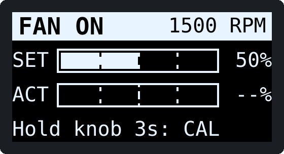 | Fan ON, RPM measured, top speed not calibrated yet: ACT shows `--%`. |
|  | Fan ON and calibrated. The thin vertical line in the ACT bar marks the SET value. |
| 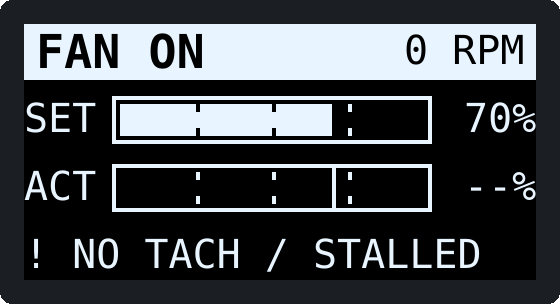 | The fan was told to run but no tach pulses arrived for 8 s. |
| 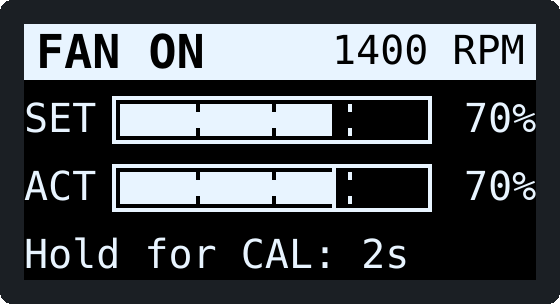 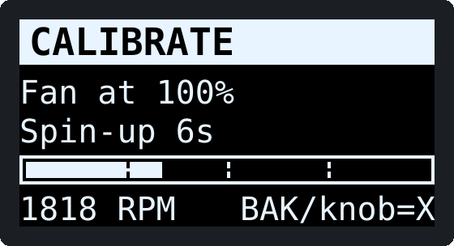 | Calibration countdown, and the calibration run. |
| 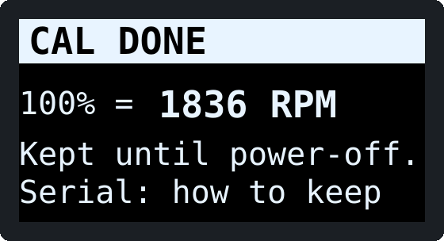 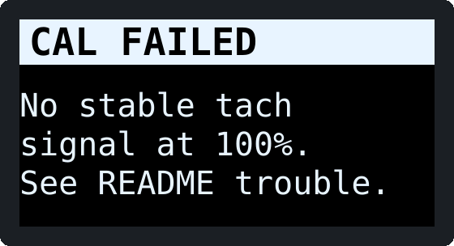 | Calibration result. |
| 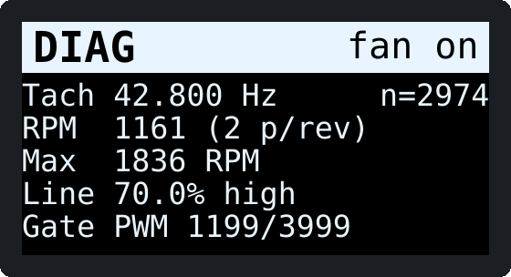 | Diagnostics page. |

**Keeping the calibration.** By design nothing is stored permanently, so a
calibration lasts until power-off. To make it permanent, connect USB once,
open the Serial Monitor (115200 baud) and calibrate: it prints a line such as
`#define TACH_MAX_RPM 1836`. Put that number into `config.h` and upload again.

**Serial console** (115200 baud, Newline): `?` help · `s` status ·
`on` / `off` · `set 40` · `c` calibrate (fan must be on) · `x` cancel ·
`m 1836` set top speed for this session. You can leave USB connected while
the fan is plugged in ([FAQ](FAQ.md#can-i-power-the-nano-from-usb-and-the-fan-at-the-same-time)).

---

## Troubleshooting

| Symptom | Likely cause | Fix |
|---|---|---|
| **Blank display**, LED L works | No 3.3 V at the module; SDA/SCL swapped or not connected; module at address 0x3D; wrong module pin order | Measure module VCC (3.25–3.35 V). Check SDA → A4, SCL → A5 by label, not position. Try `OLED_I2C_ADDRESS 0x3D`. |
| **Blank display**, nothing works | No power: F1 tripped, D1 reversed, J1 wires swapped | Measure VIN (Step 3 values). Unplug, let F1 cool for a minute, look for a short. |
| **Garbled display** (random dots, shifted picture, a column of noise at one edge) | Your board has an SSD1306, not an SH1106 | Set `OLED_SSD1306 1` in `config.h` and upload. |
| **Garbled display** that changes when the fan starts | Noise or a poor ground on the I²C wires | Keep the OLED wires short (< 30 cm) and away from the fan cable; check the GND wire to the module. |
| **Encoder skips** clicks (every other click ignored) | Encoder has 2 edges per click (15 pulses / 30 detents type) | `ENC_EDGES_PER_DETENT 2` |
| **Encoder jumps 2 per click** | The opposite: `ENC_EDGES_PER_DETENT` is 2 on a 20/20 encoder | `ENC_EDGES_PER_DETENT 4` |
| **Encoder runs backwards** | A/B swapped (module orientation) | `ENC_REVERSE 1`, or swap the TRA/TRB wires |
| **Encoder erratic** | Loose TRA/TRB/GND wire | Recheck Step 4 continuity |
| **Button doesn't toggle** | PSH not on D5, or no GND to the module | Continuity PSH → D5. Note the toggle happens on **release**; if you hold for 3 s it starts a calibration instead (only while ON). |
| **Button toggles twice** | Should not happen: presses are debounced (25 ms). If it does, the switch is failing. | Raise `BUTTON_DEBOUNCE_MS` to 50. |
| **Fan runs at full speed when it should be off** (display says FAN OFF) | Q1 not pulling the line low: Q1 backwards, R4 missing, PWM wire on the wrong J1 pin, or polarity opposite | Q1 gate should read ~5 V while OFF (Step 6). Check 2N7000 pin order S-G-D. Recheck M4; if the fan runs when the line is low, use `FAN_PWM_INVERTED 0` and R4 to GND. |
| **Fan runs at full speed for a moment at power-up** | R4 missing or wired to the wrong place | R4 must go from the Q1 gate to +5V. |
| **Fan won't stop at 0 % / OFF** (runs slowly) | This fan's minimum speed is above zero when the line is low (M4) | Expected for that fan: see [FAQ](FAQ.md#does-0-or-off-actually-stop-the-fan). |
| **Fan won't stop and runs at full** | See "full speed when it should be off" | |
| **Fan doesn't start at low settings** | EC fans need a minimum duty to start | Raise `FAN_DUTY_MIN_PCT` to the lowest duty that turns it (BENCH_TEST B6). |
| **Speed tops out at about half** | Line not reaching the fan's high level: R5 fitted when not needed, or something else loads the line | Remove R5 if M3 read ~10 V. Q1 must be fully off at 100 % (gate < 0.1 V). |
| **RPM reads 0 / "NO TACH"** while the fan clearly turns | No tach on this port (M5), TACH wire on the wrong pin, D4 backwards, or `TACH_FAULT_MS` too short for a slow-starting fan | Diagnostics page: does `n=` count? Recheck M5. D4 band must face the tach node. |
| **RPM erratic** or jumps | Noise on the tach wire, or a tach signal with slow edges | Route the tach wire away from mains; C5 must be fitted. Increase `TACH_WINDOW_MS` to 1000 or `TACH_SMOOTHING` to 8. |
| **RPM is exactly double or half the real speed** | Pulses per revolution differ from 2 | Change `TACH_PULSES_PER_REV` (ACT % is unaffected; it uses the calibration). |
| **ACT always `--%`** while RPM shows | Not calibrated in this power session | Hold the knob 3 s while ON, or set `TACH_MAX_RPM` in `config.h` |
| **CAL FAILED** | No tach, or the speed varied by more than ±10 % at 100 % (gusty ducting, fan still ramping) | Check the tach; close doors/vents; try again. Raise `CAL_SPINUP_MS` for a slow fan. |
| **Nano resets when the fan changes speed** (display flickers back to FAN OFF) | The fan's 10 V dips under load changes; poor connection in J1; C1 missing | Check J1 crimp and solder joints. C1 must be 220 µF or more (470 µF is fine). Measure VIN during a speed change: it must stay above 6.5 V. |
| **Display goes back to FAN OFF on its own**, serial says `restarted by the watchdog` | The program stalled for 2 s (should not happen) | Note what you were doing and open an issue. The fan is safely OFF after a restart. |
| **Upload fails** (`not in sync`, `programmer is not responding`) | Wrong processor setting, wrong port, charge-only cable, Serial Monitor holding the port | Try the other *Processor* option (Software setup step 7). Check *Tools → Port*. Close the Serial Monitor. Try another cable. |
| **Upload fails**, port missing | CH340 driver missing | Install CH341SER (Software setup step 6). |
| **Upload fails** only when the fan is connected | Shouldn't happen; check for a short pulling down D0/D1 | Unplug J1 and retry. |
| **Compile error** `U8g2lib.h: No such file` | Library not installed | Software setup step 3. |
| **Compile error** about `FAN_PWM_FREQ_HZ`, pins, or duty limits | A `config.h` value is out of range | The error message names the setting. |

---

## Development and tests

```sh
make -C test                    # host unit tests + firmware simulation (any C++17 compiler)
sh test/avr/run_simavr.sh       # real Nano binary in simavr (needs arduino-cli and simavr)
make -C test shots              # regenerate docs/img/screen_*.svg from the real drawing code
python3 hardware/schematic.py   # regenerate the schematic (SVG + PNG)
python3 hardware/wiring.py      # regenerate the wiring view
python3 hardware/overview.py    # regenerate the overview illustration
```

The recorded test output, compile size report and review results are in
[VERIFICATION.md](VERIFICATION.md).

Repository layout:

```
├── README.md  FAQ.md  PINOUT.md  BENCH_TEST.md  VERIFICATION.md  CHANGELOG.md  TASK.md
├── firmware/
│   ├── libraries.txt                 pinned core and library versions
│   └── cloudline_controller/
│       ├── cloudline_controller.ino  (no code: see the comment inside)
│       ├── config.h                  every tunable value and pin
│       ├── app.cpp                   hardware glue: setup/loop, ISRs, PWM, watchdog, serial
│       ├── fan_logic.h               pure logic (unit-tested on the host)
│       └── display_ui.h              screen layouts
├── test/        host tests, stubs, AVR simulation script
├── hardware/    schematic/wiring/overview sources (.py) and renders (.svg/.png), bom.csv
├── sim/         Wokwi diagram.json, wokwi.toml, libraries.txt
└── docs/img/    display screenshots (generated by the tests)
```

## Sources

- [RollItUp: ESP32 control of Cloudline EC fans](https://www.rollitup.org/t/idiots-guide-to-getting-an-esp32-to-control-ac-infinity-cloudline-ec-fans-esphome-ha.1053910/): PC-style 4-pin Molex, MOSFET low-side drive, `inverted: true`, 1 kHz works
- [RollItUp: Cloudline T6 / Hyperfan pin numbering](https://www.rollitup.org/t/how-i-hooked-up-pwm-singals-to-acinfinity-cloudline-t6-and-hyperfan-8-from-an-open-source-software.1037278/): pin 4 = +10 V, 3 = GND, 2 = PWM, 1 = not used, chamfer up, left to right
- [RollItUp: Cloudline AI-CLS6 PWM control with RPi](https://www.rollitup.org/t/cloudline-ai-cls6-s6-pwm-control-with-rpi.1046753/): 10 V provided by the fan; 100 % PWM through a transistor = off
- [chriskoz/AutoFan](https://github.com/chriskoz/AutoFan) (Cloudline S6): "4-pin molex ATX HDD connector", control wire "pulled up to 10V by the fan", stock controller ≈ 245 µs period (~4 kHz)
- [coofercat/ha-ac-infinity-fan](https://github.com/coofercat/ha-ac-infinity-fan): newer USB-C "UIS" S6: +10 V, tach on D+, PWM on D−, ~5 kHz
- [Home Assistant Community: multiple Cloudline S6 on one ESP32](https://community.home-assistant.io/t/connect-multiple-cloudline-s6-to-single-esp32/592211): half speed with direct GPIO drive
- AITRIP / generic 1.3″ OLED + EC11 module: [manuals.plus (AITRIP)](https://manuals.plus/asin/B0F87DZ51P), [makerselectronics](https://makerselectronics.com/product/oled-display-i2c-1-3-inch-module-with-ec11-rotary-encoder/), [bitsandparts](https://www.bitsandparts.nl/en/display-oled-128x160-1.3-inch-i2c-white-with-ec11-rotary-encoder-p1931809)
- Old Nano bootloader and the watchdog: [SpenceKonde, Ref_Reset.md](https://github.com/SpenceKonde/megaTinyCore/blob/master/megaavr/extras/Ref_Reset.md), [arduino/Arduino#4492](https://github.com/arduino/Arduino/issues/4492)
- Datasheets: ATmega328P (Microchip DS40002061), 2N7000 (onsemi), MCP1700 (Microchip DS20001826), P6KE series (Littelfuse), BAT85 (Nexperia/Vishay), MF-R series (Bourns), 1N5817 (onsemi)
