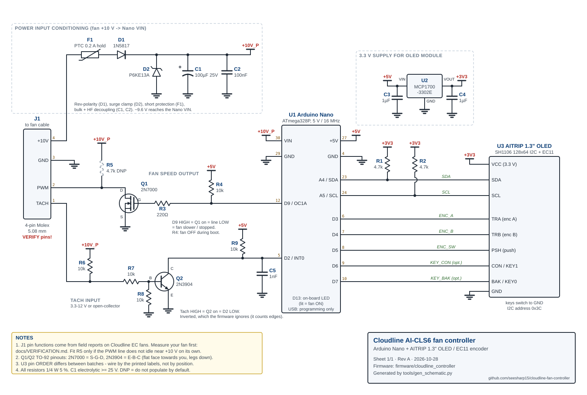

# Cloudline AI-CLS6 fan controller

A stand-alone speed controller for the **AC Infinity Cloudline AI-CLS6**
(Cloudline S6) EC exhaust fan, using an **Arduino Nano** and an **AITRIP
1.3″ OLED module with an integrated EC11 rotary encoder**. It plugs into the
fan's 4-pin Molex control lead in place of the stock controller and runs
entirely from the fan's own 10 V supply.

| | |
|---|---|
|  |  |

## What it does

- **Turn the knob** to set the speed, 0–100 % in 1 % steps (5 % per click
  when you spin it fast).
- **Press the knob** to switch the fan on or off.
- **The fan is always off at power-up.** This is enforced in hardware and in
  firmware.
- **The setting is kept while powered.** Switching off and on returns to the
  same speed. After a power cycle the setting resets to 50 %.
- **The display shows:**
  - ON/OFF status in the title bar, which is inverted while ON;
  - the **setting** as a bar and a percentage;
  - the **measured speed** from the fan's tachometer, as a bar, a percentage
    of the calibrated maximum, and RPM.
- **Extras:**
  - a 3-second hold calibrates "100 %" against the real fan, stored in
    EEPROM;
  - a "NO TACH / STALLED" warning;
  - a diagnostics page for bring-up.
- **Power:** from the fan's +10 V, through a PTC fuse, reverse-polarity
  diode, TVS clamp and decoupling, into the Nano's regulator. A separate
  3.3 V LDO feeds the OLED.

## ⚠️ Read before connecting

AC Infinity does not publish the electrical details of the control
connector. The pin functions, the inverted speed signal and the tach pin come
from builder reports. **Work through [docs/VERIFICATION.md](docs/VERIFICATION.md)
with a multimeter before connecting the controller to your fan.** The board
is designed so that the most likely surprises (a floating speed input, the
opposite polarity, no tach) can be handled with one resistor or one config
line.

## Documentation

| Document | Contents |
|---|---|
| [docs/schematic.svg](docs/schematic.svg) | Full graphical schematic: every resistor, transistor and connection |
| [docs/PINOUT.md](docs/PINOUT.md) | All pinouts (fan connector, Nano, OLED module, transistors, regulator), power rails and budget, and a point-to-point wiring list |
| [docs/VERIFICATION.md](docs/VERIFICATION.md) | Measuring the fan connector, bench bring-up without the fan, first connection, calibration |
| [docs/DESIGN_NOTES.md](docs/DESIGN_NOTES.md) | Requirements traceability, circuit calculations, firmware architecture, testing, tuning, troubleshooting |
| [docs/BOM.md](docs/BOM.md) | Parts list with part numbers and substitutes |
| [firmware/cloudline_controller/](firmware/cloudline_controller/) | Arduino sketch (`config.h` holds every tunable value) |

[](docs/schematic.svg)

## Circuit at a glance

| Block | Parts | Job |
|---|---|---|
| Power input | F1 PTC, D1 1N5817, D2 P6KE13A, C1 100 µF, C2 100 nF | Fan +10 V → protected ~9.6 V → Nano **VIN** |
| 3.3 V supply | U2 MCP1700-3302E, C3, C4 | Nano 5 V → 3.3 V for the OLED module |
| Speed output | Q1 2N7000, R3 220 Ω, R4 10 k, (R5 DNP) | D9 PWM pulls the fan's speed line low (open-drain). R4 keeps the fan OFF while the Nano boots. |
| Tach input | Q2 2N3904, R6–R9, C5 | Fan tach (3.3–12 V or open-collector) → clean 5 V pulses on D2 |
| UI | U3 module, R1/R2 4.7 k I²C pull-ups | SH1106 display on A4/A5. Encoder on D3/D4, push on D5, optional keys on D6/D7. |

## Building the firmware

1. Install the [Arduino IDE](https://www.arduino.cc/en/software) (1.8.x or 2.x).
2. **Library Manager:** install **U8g2** by olikraus.
3. Open `firmware/cloudline_controller/cloudline_controller.ino`.
4. **Tools → Board:** Arduino Nano. **Processor:** *ATmega328P*, or
   *ATmega328P (Old Bootloader)* for most clones. If an upload fails, try
   the other one.
5. Review `config.h`, especially after doing VERIFICATION.md part A. Then
   upload.

Command-line alternative:

```sh
arduino-cli lib install U8g2
arduino-cli compile -b arduino:avr:nano firmware/cloudline_controller
arduino-cli upload  -b arduino:avr:nano -p /dev/tty.usbserial-XXXX firmware/cloudline_controller
# clones with the old bootloader: -b arduino:avr:nano:cpu=atmega328old
```

## Host tests

The firmware logic and the whole sketch run on a desktop compiler against
stubs of the Arduino, AVR and U8g2 APIs. The simulation drives the knob,
buttons and a tach pulse train, and checks the PWM registers, displayed
values and the layout of every frame.

```sh
make -C tests          # build and run all suites
make -C tests shots    # regenerate docs/img/screen_*.svg from the real drawing code
python3 tools/gen_schematic.py   # regenerate docs/schematic.svg
```

See [DESIGN_NOTES.md §9](docs/DESIGN_NOTES.md#9-testing) for what is and is
not covered. In particular, the sketch has not yet been compiled with
avr-gcc or run on real hardware.

## Repository layout

```
├── TASK.md                         original brief
├── README.md
├── docs/
│   ├── schematic.svg               graphical schematic (generated)
│   ├── PINOUT.md  VERIFICATION.md  DESIGN_NOTES.md  BOM.md
│   └── img/screen_*.svg            display screenshots (generated by the tests)
├── firmware/cloudline_controller/
│   ├── cloudline_controller.ino    sketch
│   ├── config.h                    pins and tunables
│   ├── fan_logic.h                 hardware-independent logic (unit-tested)
│   └── display_ui.h                screen layouts
├── tests/                          host unit tests, simulation, Arduino/U8g2 stubs
└── tools/gen_schematic.py          schematic generator (standard library only)
```
