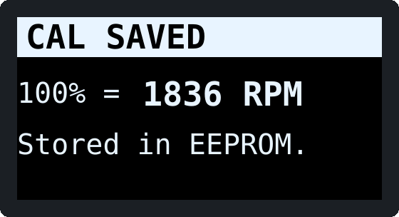

# Verification and bring-up

AC Infinity does not publish the electrical interface of the Cloudline
control connector. This design relies on reverse-engineering reports from
other builders (see [DESIGN_NOTES.md §2](DESIGN_NOTES.md#2-the-fan-interface-what-is-known)).
Before the controller touches your fan, confirm the assumptions with a
multimeter. It takes about 20 minutes.

The procedure has three parts:

- **Part A:** measure the fan's connector, using the stock controller as the
  reference.
- **Part B:** test the finished controller on the bench, without the fan.
- **Part C:** connect the fan, calibrate, and fine-tune.

You need a digital multimeter. A **Hz / duty-cycle** function helps but is
not required. You also need a couple of thin probe pins (sewing needles or
T-pins) to back-probe the connector, and for part B a 9–12 V bench supply or
wall adapter.

> **Safety.** The fan runs from mains power. Everything here happens on the
> low-voltage control cable only. Never open the fan's motor housing. Unplug
> the fan from the wall whenever you plug or unplug the control connector.

---

## Part A: measure the fan connector

Use a results table like the one at the end of this page.

### A1. Find GND and +10 V (stock controller unplugged)

1. Unplug the stock controller from the fan's 4-pin lead and plug the fan
   into the wall.
2. Set the meter to DC volts. Put the black probe on the pin reported as
   **GND (pin 3)** and measure each other pin with the red probe.
3. Expect one pin at about **+10 V**, reported as pin 4. Write down the exact
   value.
   - If it is **above 10.8 V**, swap D2 for a **P6KE15A** (see BOM).
   - If it is below 7.5 V, the Nano's regulator will not regulate. Stop and
     open an issue.
4. Sanity check: measure from the +10 V pin to each other pin. Only the GND
   pin should read the full 10 V.

**Note what the fan does with the controller unplugged.** If it spins up to
full speed on its own, the speed line idles high through an internal
pull-up, which is the behaviour this design expects.

### A2. Speed line voltage with nothing attached

Measure the reported **PWM pin (pin 2)** against GND:

| Reading | Meaning | Action |
|---|---|---|
| Close to the +10 V value | Internal pull-up to the fan supply | Expected. **Do not fit R5.** |
| A steady 4.5–5.5 V | Internal pull-up to 5 V | Fine. Do not fit R5. Full speed is reached with the line released. |
| 0 V or wandering | No pull-up: the input floats | **Fit R5** (4.7 kΩ to +10V_P) |

### A3. Pull-up strength (optional but recommended)

Set the meter to **DC mA** and connect it between the PWM pin and GND. This
is exactly what Q1 does when the fan is off. The meter shows the short-circuit
current:

- **Under 5 mA:** normal (a pull-up of 2 kΩ or more). The fan should also
  slow down or stop while the meter is connected.
- **Over 20 mA:** stop. The line is not a weak pull-up, and this design does
  not fit your fan.

### A4. Confirm polarity and frequency with the stock controller

Plug the stock controller back in. Back-probe the PWM pin by sliding a pin
into the rear of the connector next to the wire until it touches the metal
contact. Clip the meter to it, with the black lead on GND.

| Stock controller setting | DC volts on PWM pin | Hz (if your meter has it) | Duty % (if available) |
|---|---|---|---|
| OFF / 0 | | | |
| 5 | | | |
| 10 (max) | | | |

Expected: the DC reading **rises with the speed level**, from about 0 V at
OFF to near the supply at 10. A meter averages a PWM signal, so at level 5
it shows roughly half.

- **Reading rises with speed:** confirms `FAN_PWM_INVERTED 1` (the default).
- **Reading falls with speed:** your fan is the opposite way round. Set
  `FAN_PWM_INVERTED 0` in `config.h` **and** move R4 to go from the gate to
  **GND** instead of +5V. Otherwise the fan would run at full speed during
  power-up.
- **Hz reading:** if the meter shows a steady frequency at level 5, put it in
  `FAN_PWM_FREQ_HZ`. Values of 1–5 kHz are reported to work, and the default
  is 1 kHz.

### A5. Find the tach pin

Still with the stock controller attached, back-probe the remaining pin
(reported as **TACH, pin 1**):

| Setting | DC volts | Hz |
|---|---|---|
| OFF (fan stopped) | | |
| 5 | | |
| 10 | | |

- **A pulsing tach:** the DC reading sits part-way between 0 and the high
  level while the fan turns (often 30–60 % of it), and the Hz reading rises
  with speed. Typical values are tens to a few hundred Hz. The tach output is
  **open-collector** if the pin reads about 0 V with nothing connected once
  the stock controller is unplugged. Either kind works with the Q2 input
  stage.
- **Constant at every setting:** there is no tach on this connector. The
  controller still works, but the ACT bar shows `--%` with "NO TACH". See
  [DESIGN_NOTES.md §11](DESIGN_NOTES.md#11-troubleshooting).
- **Above 12 V at any time:** do not connect it. Change R7 to 22 kΩ and ask
  for a review.

### A6. Mark the cable

Label the four pins on the cable end you will use as J1 (+10V, GND, PWM,
TACH). The colours on an extension cable mean nothing. Check continuity from
each pin of the cut end back to the plug.

---

## Part B: bench test the controller (fan NOT connected)

Build the board with **U1 (Nano) and U3 (OLED) unplugged**, using sockets
and headers. Use a bench supply of 9–12 V with the current limit at 150 mA
if it has one.

### B1. Input protection

1. Connect the supply to J1: + to pin 4, − to pin 3.
2. +10V_P should read the supply voltage minus about 0.3 V (D1).
3. Current with nothing plugged in is close to zero: only C1/C2 and the TVS
   leakage, under 1 mA.
4. **Reverse-polarity check:** swap the supply leads for a moment. There
   should be no current and about 0 V on +10V_P, because D1 blocks.

### B2. Rails

1. Plug the Nano in (unprogrammed is fine).
2. Nano 5V pin: 4.9–5.1 V.
3. U2 output: 3.25–3.35 V.
4. Supply current: about 20–30 mA.

### B3. Program the Nano

See [README.md → Building the firmware](../README.md#building-the-firmware).
USB can stay connected while the 10 V supply is on. The Nano picks
whichever 5 V source is higher.

### B4. Display

1. Plug in U3 **by its labels**.
2. Before you rely on 3.3 V being right, look at the module's back for a
   3-pin regulator (SOT-23 marked `662K`, `65K5`, `XC6206` or similar). If
   it has one, VCC also tolerates 5 V, but 3.3 V is still fine.
3. Power up. You should see the **FAN OFF** screen:

   

4. **Blank display:** check SDA/SCL are not swapped. Check R1/R2 are
   fitted. Check 3.3 V at VCC. Some boards are strapped to address 0x3D: try
   `OLED_I2C_ADDRESS 0x3D`.
5. **Image shifted by 2 pixels, with a garbage column:** the board has an
   SSD1306. Set `OLED_SSD1306 1`.

### B5. Encoder and keys

1. Turning the knob changes **SET** in 1 % steps (5 % when spun quickly),
   between 0 and 100 %. If clockwise lowers the value, set `ENC_REVERSE 1`.
2. A press toggles **FAN ON / FAN OFF**, and D13 lights while ON.
3. The CON key opens the diagnostics page and BAK goes back.

### B6. Speed output (simulating the fan's pull-up)

Fit a **temporary 10 kΩ resistor from J1 pin 2 to +10V_P**, to stand in for
the fan's internal pull-up. Measure DC volts on J1 pin 2:

| State | Expected on J1 pin 2 |
|---|---|
| FAN OFF | **0 V** (Q1 on) |
| FAN ON, SET 25 % | ~2.4 V (meter average) |
| FAN ON, SET 50 % | ~4.8 V |
| FAN ON, SET 100 % | ~9.7 V (Q1 off) |

**Power-up check (the most important one):**

1. Set the meter to MIN/MAX if it has it, or watch closely.
2. Unplug and replug the supply a few times.
3. J1 pin 2 must **stay at 0 V** the whole time, both while the Nano boots
   and while the screen comes up.

This is the "fan must be off at power-up" requirement, enforced in
hardware by R4. Remove the temporary resistor afterwards.

### B7. Tach input

Open the diagnostics page with the CON key, or hold the knob while powering
up. Then feed J1 pin 1 any of these:

- A jumper wire tapped between J1 pin 1 and GND a few times. **n=** counts
  up, about one count per tap, with a few extra from contact bounce.
- A square wave from a function generator or another Arduino, for example
  `tone(pin, 50)` from a second board sharing GND. **Tach** should read
  50.000 Hz and **RPM** 1500 at 2 pulses/rev.

---

## Part C: connect the fan

1. Unplug the fan from the wall. Plug J1 into the fan's control lead. Plug
   the fan back in.
2. The display should come up with **FAN OFF**, and the fan stays still.
3. Press the knob. The fan runs at the default 50 %, and after a few
   seconds the ACT bar and RPM follow.
4. **Calibrate** (this sets what "100 %" means on the ACT bar):
   1. With the fan ON, hold the knob for 3 s.
   2. The fan runs at 100 % for 18 s: 12 s of spin-up, then 6 s of
      measurement.
   3. The measured RPM is stored in EEPROM and kept across power cycles.
   4. Repeat this if you change the ducting or the fan, since static
      pressure changes the top speed.

    

5. **Optional: pulses per revolution.**
   1. Measure the real fan speed with an optical tachometer, or with a phone
      strobe/slow-motion video of a marked blade.
   2. Compare it with the **Tach Hz** on the diagnostics page:
      `TACH_PULSES_PER_REV = Hz × 60 / true RPM`. Round to a whole number.
   3. This only changes the displayed RPM. The percentages already come from
      the calibration.
6. **Optional: minimum start duty.**
   1. Lower SET until ACT drops to 0 %.
   2. Put a value just above that in `FAN_DUTY_MIN_PCT`, so that 1 % on the
      knob is the slowest speed that still turns.

---

## Results template

Copy this into an issue or your notes:

```
Fan model / label:            AI-CLS6, serial ______
+10 V pin:  ___  measured ____ V   (A1)
GND pin:    ___
PWM pin:    ___  idle ____ V, short-circuit ____ mA (A2/A3)
            stock ctrl  OFF ____ V   L5 ____ V / ____ Hz   L10 ____ V  (A4)
TACH pin:   ___  OFF ____ V   L5 ____ V / ____ Hz   L10 ____ V / ____ Hz  (A5)
Fan with controller unplugged:  stops / full speed / other: ______
R5 fitted:  yes / no      FAN_PWM_INVERTED: 1 / 0     PWM freq: ____ Hz
Calibrated max RPM: ______    Pulses/rev: ___    Min start duty: ___ %
```
