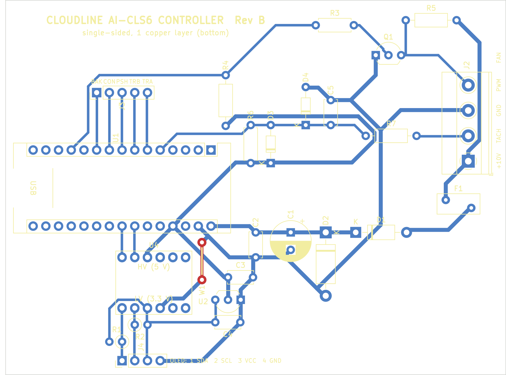
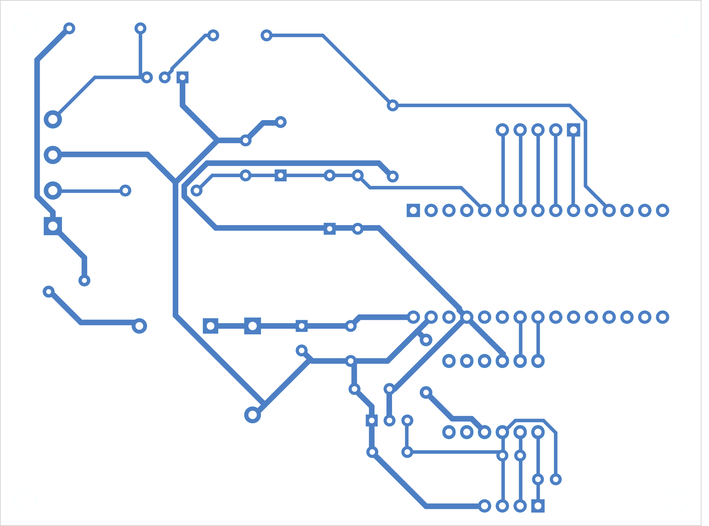

# Cloudline controller PCB: from files to finished board

The controller on a printed circuit board instead of perfboard:

- **one copper layer** (the bottom), no wire links;
- all parts through-hole, on the top;
- 100 × 75 mm, four M3 mounting holes.

It carries every part in [the schematic](../schematic.svg), plus a 4-way screw
terminal for the fan cable and two pin headers for the OLED module.

This page covers everything about the board:

- the three ways to get a board made, and every file involved;
- a **walkthrough in separate sessions**, from opening the files to a
  finished, boxed controller;
- reference: design notes, how the board was checked, regenerating the files.

| Top (parts side) | Bottom copper (as seen from below) |
|---|---|
|  |  |

> **Status: designed and checked, not yet made.** The files pass KiCad's
> design-rule check, an independent copper-connectivity check, an independent
> review, and the milling and EAGLE export checks below. No board has been
> built from them yet, and nothing has been opened in Fusion 360 or run on the
> machine. Build the first one expecting to find something.

## Contents

1. [Three ways to get a board](#three-ways-to-get-a-board)
2. [Your setup (milling)](#your-setup-milling)
3. [Files](#files)
4. [The walkthrough, session by session](#the-walkthrough-session-by-session)
   - [How the sessions work](#how-the-sessions-work) · [Progress log](#progress-log)
   - [S0 Gather materials](#s0-gather-materials-and-check-the-fan)
   - [S1 Get the files](#s1-get-the-files)
   - [S2 Review or edit in Fusion Electronics (optional)](#s2-review-or-edit-in-fusion-electronics-optional)
   - [S3 Prepare and measure the blank](#s3-prepare-and-measure-the-blank)
   - [S4 Fusion: import](#s4-fusion-import-model-tools-isolation-paths)
   - [S5 Fusion: setup and operations](#s5-fusion-setup-and-operations)
   - [S6 Fusion: simulate and post](#s6-fusion-simulate-and-post)
   - [S7 Machine: prepare, mount, zero](#s7-machine-prepare-mount-zero)
   - [S8 Machine: isolation](#s8-machine-isolation-t1)
   - [S9 Machine: drilling](#s9-machine-drilling-t2t6)
   - [S10 Machine: outline](#s10-machine-outline-t7)
   - [S11 Clean, inspect, test the bare board](#s11-clean-inspect-and-test-the-bare-board)
   - [S12–S17 Assembly and first power-up](#s12s17-assembly-and-first-power-up)
   - [S18 Enclosure](#s18-enclosure)
5. [Ordering from a board house](#ordering-from-a-board-house)
6. [Design notes](#design-notes) · [Verification](#verification) · [Regenerating](#regenerating)

## Three ways to get a board

| Route | Use | Sessions |
|---|---|---|
| **A. Mill it** on the Stepcraft M.1000 with Fusion 360 | Files in [`fusion/`](fusion/README.md) | S0 → S18, all of them |
| **B. Order it** from a board house | Upload [`fab/cloudline_controller_RevB_gerbers_drill.zip`](fab/cloudline_controller_RevB_gerbers_drill.zip), see [Ordering](#ordering-from-a-board-house) | S0, S1, order, then S11 → S18 |
| **C. Etch it** at home by toner transfer | Print [`fab/bottom_copper_toner_transfer_1to1.pdf`](fab/bottom_copper_toner_transfer_1to1.pdf) at 100 % | S0, S1, etch, drill by hand, then S11 → S18 |

To **change the circuit or the layout**, use Fusion Electronics (session S2).
The milling files in `fusion/` and the Gerbers in `fab/` are made from the
KiCad copy of the board. They don't change when you edit in Fusion. See
[Which copy is master](#which-copy-is-master).

## Your setup (milling)

The milling files and the walkthrough are made for this setup:

| | |
|---|---|
| Machine | Stepcraft M.1000 with tool changer |
| Control software | UCCNC (Autodesk's *UCCNC* post in Fusion) |
| Spindle | Stepcraft DI 1000, 8 000–20 000 rpm |
| CAM | Fusion 360, commercial licence: one program with all tool changes, real rapids |
| Blank | FR-4; thickness is measured in S3; the copper weight doesn't matter (the cut works for 35 and 70 µm) |
| Workholding | Double-sided tape, Z touch plate, **no height map** |
| Tools (T1–T7) | T1 V-bit 30° with 0.1 mm tip · T2 0.8 mm drill · T3 1.0 · T4 1.2 · T5 1.3 · T6 3.2 · T7 2 mm 2-flute end mill |

**Assumed and to confirm:**

- the V-bit's angle and tip;
- the outline end mill size;
- the tool numbers in your changer.

[S4](#s4-fusion-import-model-tools-isolation-paths) says how to change any of these.

**Board numbers that matter for milling:**

- **Gaps:** the smallest gap between copper of different nets is **0.64 mm**.
  It sits between neighbouring 2.54 mm-pitch header pads, and no layout can
  make it larger. Tracks keep at least 0.69 mm from other copper. Copper is
  at least 3.15 mm from the board edge.
- **Isolation cut:** two passes with the V-bit, **0.20 mm deep**,
  0.207 mm wide. That clears about 0.33 mm around every pad and track.
  - The paths were simulated for a board up to **±0.10 mm** off the Z
    touch-off height, because there is no height map.
  - At 0.10 mm deep the cut still goes through 70 µm copper and isolates
    every net.
  - At 0.30 mm deep it trims 0.027 mm off copper edges, which is harmless.
- **Holes:** 99, all non-plated:

  | Size | 0.75 | 0.80 | 1.00 | 1.10 | 1.20 | 1.30 | 3.20 (M3) |
  |---|---|---|---|---|---|---|---|
  | Count | 4 | 32 | 51 | 2 | 2 | 4 | 4 |

## Files

**For milling (route A):** [`fusion/`](fusion/README.md)

| File | What it is |
|---|---|
| `fusion/cloudline_pcb_MILL_copper_up.step` | **The model to machine**, copper side up as it lies on the machine. It holds the FR-4 body with all holes, and one 0.035 mm copper body per net. The origin is the board's lower-left corner. Z = 0 is the underside; the copper top is at Z = 1.635. |
| `fusion/cloudline_pcb_MILL_copper_up.dxf` | Same view in 2D, in mm. Layers: `ISO_PASS1`/`ISO_PASS2` (isolation tool-centre paths), `DRILL_*` (one per hole size), `OUTLINE`, `COPPER`, `FIDUCIAL` |
| `fusion/cloudline_pcb_tools.json` | Fusion tool library T1–T7, with feeds and speeds for the DI 1000 |
| `fusion/cloudline_pcb_TOPVIEW.step` | The board seen from the parts side, for checks or an enclosure model. **Not for machining.** |
| `fusion/milling_report.txt`, `fusion/isolation_preview.png`, `fusion/mill_preview.png` | Gaps, hole table and cut-width table, and pictures of the paths and copper |

**For editing (Fusion Electronics):** [`eagle/`](eagle/README.md)

| File | What it is |
|---|---|
| `eagle/cloudline_controller.sch` + `.brd` | Schematic and board in EAGLE 9 format, linked, with the parts library embedded |
| `eagle/schematic_preview.png` | What the schematic sheet looks like |

**For ordering or etching (routes B, C):** `fab/`

| File | What it is |
|---|---|
| `fab/cloudline_controller_RevB_gerbers_drill.zip` | **Upload this to the board house.** Gerbers, Excellon drill, and `FAB_NOTES.txt` |
| `fab/gerbers/` | The same files unzipped, plus a drill map (PDF) |
| `fab/bottom_copper_toner_transfer_1to1.pdf` | Bottom copper at 1:1 for toner transfer. Print it as is: laying the print face-down mirrors it correctly. |
| `fab/gerbv_*.png`, `fab/render_*.png` | Renders. The `gerbv_*` ones are drawn from the Gerber files themselves. |
| `fab/drc_report.txt` | KiCad design-rule check report |

**For every route:**

| File | What it is |
|---|---|
| [`fab/assembly_top.pdf`](fab/assembly_top.pdf) | **Assembly drawing at 1:1**: every part outline, reference and pad. On a milled or etched board this replaces the silkscreen. |
| [`fab/pcb_bom.csv`](fab/pcb_bom.csv) | Parts by reference, value and footprint. Part numbers and prices are in [`../bom.csv`](../bom.csv). |
| `cloudline_controller.kicad_pcb`, `.kicad_pro`, `fp-lib-table`, `cloudline.pretty/` | The KiCad 7 project (the master copy) |
| `make_pcb.py`, `make_fab.py`, `drc.py`, `check_pcb.py` | Generate and check the board and the `fab/` files |
| `fusion/make_fusion.py`, `make_tool_library.py`, `check_fusion.py`; `eagle/make_eagle.py`, `check_eagle.py` | Generate and check the milling and EAGLE files |

## The walkthrough, session by session

### How the sessions work

Each session is a block of work you can finish in one sitting, and each ends
at a **checkpoint**: a state you can safely leave and come back to. Every
session has:

- **Start:** the checkpoint you need before you begin.
- **Steps.**
- **Checkpoint:** how you know the session is done, and what to record.
- **If something goes wrong:** how to back out or resume, without starting over.

Three habits make this work:

1. **Save a Fusion version at every checkpoint.** Use *File → Save* with a
   description, for example `S5 done`. A mistake later in Fusion is then
   undone by opening the version before it from the Data Panel, under
   *Versions*.
2. **Post one file per operation as well as the full program.** Then a stop
   in the middle of the job is resumed by running the remaining files. You
   never restart a half-finished program or search for a line number.
3. **Don't move the blank and don't re-zero X/Y between S7 and S10.** As long
   as the blank stays taped down and X/Y zero is unchanged, any machine session
   can be repeated or resumed, even on another day.

### Progress log

Copy this table into a notebook or a text file next to the job and fill it
in as you go. Then a session can be resumed by someone else, or by you a week
later.

| Session | Done (date) | Record |
|---|---|---|
| S0 Materials | | Tools in slots T1…T7; fan pre-connection checks M1–M6 done? |
| S1 Files | | Repository commit / download date |
| S2 Fusion Electronics | | Edited? (if yes: milling files no longer match) |
| S3 Blank | | Blank size ____ × ____ mm, **thickness ____ mm** |
| S4 Fusion import | | Fusion version saved |
| S5 Setup and ops | | Fusion version saved |
| S6 Post | | Files posted: full + 1…7 |
| S7 Machine prep | | Corner heights: ____ / ____ / ____ / ____ (centre = 0) |
| S8 Isolation | | Depth used (−0.20 or deeper) |
| S9 Drilling | | Holes OK? |
| S10 Outline | | |
| S11 Bare board test | | Shorts found / fixed |
| S12–S17 Assembly | | Last README step passed |
| S18 Enclosure | | |

### S0. Gather materials and check the fan

**Start:** nothing. **Time:** as long as shopping takes.

1. **Board materials** (route A):
   - an FR-4 single-sided copper-clad blank, at least 110 × 85 mm (100 × 160
     Eurocard is fine);
   - thin double-sided tape;
   - a fine abrasive pad (Scotch-Brite), isopropyl alcohol;
   - optional: solder-through flux lacquer.
2. **Tools** for the tool changer:

   | Slot | Tool |
   |---|---|
   | T1 | V-bit 30°, 0.1 mm tip |
   | T2 | 0.8 mm drill |
   | T3 | 1.0 mm drill |
   | T4 | 1.2 mm drill |
   | T5 | 1.3 mm drill |
   | T6 | 3.2 mm drill |
   | T7 | 2 mm end mill |

   All carbide, 3.175 mm shank where possible. Put them in the changer and
   **write down the slot numbers**. If they aren't 1–7, you will renumber them
   in S4.
3. **Measuring and testing:** calipers, a multimeter with continuity beep,
   and a loupe or magnifier.
4. **Electronic parts:** [`../bom.csv`](../bom.csv) has part numbers.
   [`fab/pcb_bom.csv`](fab/pcb_bom.csv) lists them by board reference. The
   ceramic capacitors need **5 mm lead pitch**.
5. **Safety:** FR-4 dust is fine glass fibre. Use the dust extraction or a
   vacuum during every cut, wear a dust mask and eye protection, and never blow
   the dust away.
6. **The fan:** do the main README's
   [pre-connection verification](../../README.md#pre-connection-verification)
   (checks M1–M6) whenever the fan is to hand. Its results decide whether R5
   is fitted and whether anything else changes (S16).

**Checkpoint:** you have the materials and parts, and the tool slots are
recorded.

### S1. Get the files

**Start:** S0. **Time:** 10 minutes.

1. Download the repository: on GitHub, *Code → Download ZIP*, or
   `git clone https://github.com/seesharp15/cloudline-fan-controller`.
2. You need these folders: `hardware/pcb/fusion/`,
   `hardware/pcb/eagle/` (only for S2) and `hardware/pcb/fab/`.
3. **Print** [`fab/assembly_top.pdf`](fab/assembly_top.pdf) at **100 %**
   (not "fit to page"). Check that the board outline measures 100 × 75 mm
   with a ruler. You'll use it in S11–S17.

**Checkpoint:** the files are on the computer running Fusion, and the
assembly drawing is printed at the right scale.

**Route B:** go to [Ordering](#ordering-from-a-board-house), then continue at S11.

### S2. Review or edit in Fusion Electronics (optional)

**Start:** S1. **Time:** 15 minutes to look, longer to edit.

1. In Fusion's **Data Panel**, choose *Upload* and select **both**
   `eagle/cloudline_controller.sch` and `eagle/cloudline_controller.brd` in
   one go. Fusion converts them into one electronics design with a linked
   schematic and board.
2. Open it. Run **ERC** on the schematic and **DRC** on the board. The board
   carries the rule set `cloudline_single_sided`:
   - 0.6 mm clearance;
   - 0.4 mm minimum track width;
   - 0.8 mm from copper to the board edge.
3. When editing:
   - Route on the **Bottom** layer only. Fusion draws a top-side ring on
     through-hole pads; on the real board that ring doesn't exist.
   - The schematic connects parts by **net labels**: a pin stub carrying the
     net name. Pins with the same label are the same net.
4. Save a version.

**Checkpoint:** the design opens, and ERC and DRC show nothing unexpected.

**If you changed the board:** the milling files in `fusion/` no longer
match it. Machine the edited board from Fusion's own 3D PCB instead of
S4's STEP and DXF. The setup and operations in S5 stay the same idea, but
the isolation needs a Trace or 2D Contour around the copper Fusion
generates. If you only looked, carry on with S3 unchanged.

### S3. Prepare and measure the blank

**Start:** S1. **Time:** 20 minutes.

1. Cut the blank to size, at least **110 × 85 mm**, which leaves 5 mm around
   the board. Deburr the edges so it lies flat.
2. **Measure the thickness** with calipers at all four corners. Record the
   **largest** value in the log; it goes into the Fusion stock in S5.
   Typical values are 1.5–1.6 mm.
3. Clean the copper with the abrasive pad, then alcohol. Don't touch it with
   bare fingers afterwards.

**Checkpoint:** the blank is cut and clean, and its size and thickness are
recorded.

### S4. Fusion: import model, tools, isolation paths

**Start:** S1 (and the thickness from S3, needed in S5). **Time:** 20 minutes.

1. **Model:** upload `fusion/cloudline_pcb_MILL_copper_up.step` and open it.
   Check that the board's corner is at the origin and the copper is on top.
   The Nano's row of pads is near the right edge.
2. **Tool library:**
   1. In *Manufacture → Tool Library*, right-click a local library folder
      and choose *Import tool libraries…*, then pick
      `fusion/cloudline_pcb_tools.json`.
   2. Open each tool and set its **number** to its slot in your changer.
   3. If your V-bit isn't 30° with a 0.1 mm tip, or your outline end mill
      isn't 2 mm, correct the tool's geometry here.

   For a different V-bit, also change `VBIT_ANGLE` / `VBIT_TIP` in
   `fusion/make_fusion.py`, run the script, and re-import the DXF. The
   isolation paths are made for a specific bit. See
   [`fusion/README.md`](fusion/README.md#regenerating).

   The library follows Fusion's JSON format, but it hasn't been tested in
   Fusion. If the import fails, create the seven tools by hand from the
   [feeds and speeds table](fusion/README.md#feeds-and-speeds).
3. **Isolation paths:**
   1. In *Design*, create an **offset plane 1.635 mm** above the XY plane.
   2. Create a sketch on it, then use *Insert → Insert DXF* to bring in
      `fusion/cloudline_pcb_MILL_copper_up.dxf`, mm, at origin 0,0.
   3. The `ISO_PASS1`/`ISO_PASS2` curves now lie on the copper surface,
      right on top of the model.
4. **Save a version:** `S4 imported`.

**Checkpoint:** the model, the 7 tools with correct numbers, and the DXF
sketch at Z = 1.635 are all in one saved design.

**If something goes wrong:**

- The DXF lands in the wrong place: delete the sketch and redo step 3.
  Check that the units are mm and the plane is at 1.635.
- The tool import fails: create the tools by hand as described in step 2.

### S5. Fusion: setup and operations

**Start:** S4, and the blank thickness from S3. **Time:** 45 minutes.

**Setup** (*Manufacture → Setup → New Setup*):

- **Machine:** your Stepcraft M.1000 definition, or a generic 3-axis mill.
- **Stock:** *Fixed size box*.
  - X × Y = blank size.
  - **Z = measured thickness.**
  - Model position: X *offset from left* 5 mm, Y *offset from front* 5 mm,
    Z *offset from top* **0**.
- **WCS:** Z up. Origin *Stock box point*, **top, front-left corner**.
- **Model:** all bodies.

**Operations**, in this order, all in the one setup:

| # | Operation | Tool | Geometry | Key settings |
|---|---|---|---|---|
| 1 | 2D → **Trace** | T1 | Every curve on `ISO_PASS1` | Bottom height: *Selected contour(s)*, offset **−0.20 mm**. No compensation (these are tool-centre lines). No multiple depths. |
| 2 | 2D → **Trace** | T1 | Every curve on `ISO_PASS2` | Same as op 1 |
| 3 | Drilling → **Drill** | T2 | Holes of 0.75 and 0.80 mm (click one of each, *Select same diameter*) | Cycle: *Chip breaking – partial retract*, peck 0.5 mm. Bottom: *Stock bottom*, *Drill tip through bottom*, break-through 0.5 mm. *Optimize order*. |
| 4 | Drill | T3 | 1.00 mm holes (51) | As op 3 |
| 5 | Drill | T4 | 1.10 and 1.20 mm holes (2 + 2) | As op 3 |
| 6 | Drill | T5 | 1.30 mm holes (4, screw terminal) | As op 3 |
| 7 | Drill | T6 | 3.20 mm holes (4, mounting) | Cycle: *Deep drilling – full retract* |
| 8 | 2D → **2D Contour** | T7 | Bottom outer edge of `FR4_substrate`, tool outside | Bottom: *Stock bottom* −0.2 mm. Multiple depths, 0.5 mm step-down. Tabs: 4 × 3 mm wide, 0.6 mm thick. |

You have every drill size, so you can also use a 0.75 mm and a 1.1 mm drill
for those holes. That gives a better fit, but costs two more tool changes.

The speeds and feeds come from the tool library presets. They are listed in
[`fusion/README.md`](fusion/README.md#feeds-and-speeds).

**Save a version:** `S5 operations`.

**Checkpoint:** the setup and eight operations exist, and every operation
shows a generated toolpath with no warnings.

**If something goes wrong:**

- An operation shows an error: open it and check the tool, geometry and
  heights against the table.
- The stock is wrong: edit the setup. The operations regenerate on their own.

### S6. Fusion: simulate and post

**Start:** S5. **Time:** 20 minutes.

1. **Simulate** the whole setup with stock.
   - **Isolation:** compare the result with
     [`fusion/isolation_preview.png`](fusion/isolation_preview.png). Every
     pad and track must be surrounded by a closed groove.
   - **Drills:** each one goes through the stock.
   - **Outline:** goes all the way round, with the 4 tabs.
   - **Collisions:** none, and no rapid moves through the stock.
2. **Post the full program:**
   1. Select the setup and choose *Post Process*.
   2. In the post library, search for **UCCNC** and choose Autodesk's *UCCNC*
      post. Units are mm.
   3. Name the file `cloudline_ALL.nc`.
3. **Post each tool on its own**, to resume from:
   - `cloudline_1_iso.nc`: ops 1 and 2, selected together;
   - `cloudline_2_drill08.nc` through `cloudline_6_drill32.nc`: ops 3 to 7,
     one file each;
   - `cloudline_7_outline.nc`: op 8.
4. Open `cloudline_ALL.nc` in a text editor and check:
   - it contains `T1 M6`, then `T2 M6` and so on, in the order of the
     operations;
   - the spindle speeds are no higher than `S20000`.
5. Copy the 8 files to the UCCNC computer.
6. **Save a version:** `S6 posted`.

**Checkpoint:** the 8 `.nc` files are on the machine computer.

**If something goes wrong:** a simulation problem means going back to S5,
fixing the operation, and posting again. The NC files are always re-created
from the saved Fusion version.

### S7. Machine: prepare, mount, zero

**Start:** S3 and S6. **Time:** 45 minutes.

1. **Surface the spoilboard** where the blank goes. Use a large flat end
   mill, about 0.2 mm deep. Vacuum up the dust.
2. **Tape the blank down:**
   1. Cover the **whole** back with thin double-sided tape. Tape only at the
      edges lets the middle bow up.
   2. Lay the blank square to the X axis and press it down hard, especially
      in the middle.
3. **Zero X/Y** at the blank's **front-left corner**. This is the WCS
   origin from S5. Use a pointed tool or an edge finder.
4. **Zero Z** on the copper at the board centre with the touch plate and
   **T1** loaded:
   - X = 5 + 50 = 55 mm;
   - Y = 5 + 37.5 = 42.5 mm.

   Make sure your tool-changer setup measures every other tool's length
   relative to this zero; check the UCCNC/Stepcraft tool-length routine.
5. **Flatness check** (this replaces the height map):
   1. With the touch plate, probe the copper height at the four board corners:
      (5 + 5, 5 + 5), (95 + 5, 5 + 5), (5 + 5, 70 + 5) and (95 + 5, 70 + 5) mm.
   2. Record each height relative to the centre.
   3. All four must be within **±0.10 mm**. If any is off, lift the blank,
      re-tape it or re-surface, and repeat from step 2.
6. **Dry run:**
   1. Raise the work Z by +5 mm (for example with the UCCNC Z offset).
   2. Run `cloudline_ALL.nc` in the air and watch the tool changes and that
      the paths stay over the blank.
   3. Then **remove the +5 mm offset**.

**Checkpoint:** the blank is taped flat (corner heights recorded), X/Y and Z
are zeroed, and the dry run is clean. **From here on, don't touch the blank or
re-zero X/Y until S10 is done.**

**If something goes wrong:**

- The flatness check fails: re-tape and re-check before cutting anything.
- The dry run hits a soft limit or looks wrong: stop. Check the WCS (S5),
  the X/Y zero and the post settings.

### S8. Machine: isolation (T1)

**Start:** S7. **Time:** about 15 minutes running, plus inspection.

1. Run `cloudline_1_iso.nc`. Keep the dust extraction on.
2. **Inspect before going on.** Vacuum the board, then look with a loupe:
   - Every track and pad should be surrounded by a groove down to bare FR-4.
   - Copper that still bridges a groove means the cut was too shallow there.
3. **If there are bridges:**
   1. In Fusion, change ops 1–2's bottom offset to **−0.25 mm** and post
      `cloudline_1_iso.nc` again.
   2. Run it again **without re-zeroing**. The deeper cut follows the same
      paths, and the copper edges only lose about 0.04 mm.
   3. A worn V-bit tip also leaves bridges; replace the bit before you go
      deeper than −0.30 mm.
   4. Lone bridges can also be scraped away with a sharp knife after S10.

**Checkpoint:** all grooves are clean. Record the depth used.

**If something goes wrong:**

- The run stopped part-way: run `cloudline_1_iso.nc` again from the start.
  The finished grooves are simply cut again, which does no harm.
- X/Y zero was lost: re-find the blank's front-left corner exactly. The
  `FIDUCIAL` marks in the DXF help to check it. A shift of 0.1 mm or more
  will cut into tracks. If in doubt, start a new blank at S7.

### S9. Machine: drilling (T2–T6)

**Start:** S8. **Time:** about 20 minutes.

1. Run `cloudline_2_drill08.nc` through `cloudline_6_drill32.nc`, in order.
   Alternatively, run the drill part of `cloudline_ALL.nc` if you are
   confident.
2. After each file, check that every hole of that size is drilled through
   (hold the board against the light only after S10).
3. Small carbide drills snap if anything wobbles. Keep the collet clean and
   the drill fully seated.

**Checkpoint:** all 99 holes are drilled.

**If something goes wrong:**

- A drill broke: replace it. Measure its length again with the tool-length
  routine. Then rerun **only that size's file**; holes already drilled are
  drilled again harmlessly.
- The stop was in the middle of a file: rerun that file.

### S10. Machine: outline (T7)

**Start:** S9. **Time:** about 10 minutes.

1. Run `cloudline_7_outline.nc`.
2. Vacuum the dust. Lift the board out, then break or cut the 4 tabs and file
   the tab stubs flush.
3. Remove the tape residue with alcohol.

**Checkpoint:** you have a loose 100 × 75 mm board.

**If something goes wrong:** the run stopped, so rerun the file. Every pass
repeats harmlessly, as long as the blank hasn't moved.

### S11. Clean, inspect and test the bare board

**Start:** S10 (or a board from a board house, or etched). **Time:** 30 minutes.

1. Scrub the copper with the abrasive pad, then alcohol.
2. Look at every gap with the loupe, against
   [`fusion/isolation_preview.png`](fusion/isolation_preview.png) (mill
   side) or [`fab/gerbv_copper_bottom.png`](fab/gerbv_copper_bottom.png).
3. **Continuity test for shorts:** test neighbouring pads with the meter's
   beep, especially the closest pairs in
   [`fusion/milling_report.txt`](fusion/milling_report.txt):
   - the Nano socket rows;
   - J3 and J4;
   - U4's two rows;
   - +3V3 against SDA_3V3/SCL_3V3 near R1/R2.

   Beeping between different nets means a sliver. Cut it with a knife and
   test again. **Test +5V to GND and +10V to GND** at the end.
4. Optional: coat the copper with solder-through flux lacquer.

**Checkpoint:** no shorts between different nets. Record what was fixed.

### S12–S17. Assembly and first power-up

Assembly follows the main README's build steps. **Each README step is one
session.** Every one ends with its own measurements, so a mistake is caught
at the step that made it. Solder on the copper side; the parts go on the
side **without** copper. Use the printed assembly drawing (S1) for
positions, because a milled board has no silkscreen.

| Session | README step | Fit | Then check |
|---|---|---|---|
| **S12** | [2. Power conditioning](../../README.md#step-2-build-the-power-conditioning) | **J2** screw terminal (wire entries facing the board edge), **F1**, **D1** (band = K), **D2** (band = K), **C1** (+ as on the drawing), **C2**, the two **1×15 female headers** for the Nano | Step 2's checks |
| **S13** | [3. Power test, no Nano](../../README.md#step-3-test-the-power-section-with-no-nano) | — | VIN = supply − 0.05…0.3 V on the Nano socket's VIN hole (bottom row, right end, next to C2) |
| **S14** | [4. Regulator, level shifter, OLED headers](../../README.md#step-4-wire-the-33-v-regulator-oled-and-encoder) | **U2** (flat side as drawn), **C3**, **C4**, **R1**, **R2** (standing up, body over the round mark), **U4** on its male headers with the **HV row towards the Nano** (its GND pins stay unconnected, which is correct), **J3**, **J4** | Step 4's checks |
| **S15** | [5. Flash, USB only](../../README.md#step-5-flash-and-test-with-usb-power-only) | Nano into the socket, **USB end at the board edge**: its VIN pin goes into the hole at the right end of the bottom row, next to C2. See [Software setup](../../README.md#software-setup). | Step 5's checks |
| **S16** | [6. Fan interface](../../README.md#step-6-wire-the-fan-interface) | **Q1** (flat side as drawn), **R3**, **R4**, **R6**, **R7**, **D3**, **D4** (bands as drawn), **C5**; **R5** only if check M3 said so | Step 6's checks |
| **S17** | [7. First power-up](../../README.md#step-7-first-power-up-on-the-fan-supply) | Fan cable into **J2**, matched by function (table below) | Step 7 |

**TO-92 parts (Q1, U2):** the footprint has 2.54 mm between leads. If your
parts have straight 1.27 mm leads, bend the two outer leads out by about
1.3 mm.

**Fan cable into J2.** The terminal order is not the Molex pin order:

| J2 terminal (label) | J2 pin | Fan Molex pin (J1) |
|---|---|---|
| +10V | 1 (bottom) | 4 |
| TACH | 2 | 1 |
| GND | 3 | 3 |
| PWM | 4 (top) | 2 |

**If the pre-connection checks (S0) asked for a change:**

- **M3** (no internal pull-up): fit R5. It has its place on the board.
- **M4, opposite polarity:**
  1. R4's +5V end is a fixed track. Cut that track at R4's lower pad (pad 2,
     the end away from the D9 track).
  2. Run a short wire from that pad to GND.
  3. Set `FAN_PWM_INVERTED 0`.
- **M4b, RC filter:** there's no place for it on the board. Fit the series
  resistor in the fan cable's PWM wire, and the capacitor across J2's PWM
  and GND terminals.
- **M5** (more than 12 V on the tach pin): leave the fan's TACH wire out of J2.

**OLED module:** use nine female-female jumper wires, matched by label. J3's
`BAK CON PSH TRB TRA` go to the module's pins of the same name; J4's
`SDA SCL VCC GND` likewise.

**Resuming assembly:** the log records the last README step whose checks
passed. Start at the next one. If a check fails, the fault is in what that
step fitted. The README's [troubleshooting](../../README.md#troubleshooting)
table helps.

### S18. Enclosure

**Start:** S17 passed. **Time:** 1 hour.

1. Choose a box whose **inside** is at least **115 × 90 × 35 mm**. That
   leaves room for the box's corner screw posts and the socketed Nano (about
   20 mm tall). Box makers publish drawings with inside sizes.
2. Mount the board on four M3 standoffs, about 6 mm tall, through its own
   holes. Use the printed assembly drawing as a drilling template for the box
   floor.
3. Cut an opening at the board's left edge for the Nano's USB plug, and fit a
   cable gland near J2 so the cable can't pull on the terminal.
4. Main README [step 8](../../README.md#step-8-fit-it-in-the-enclosure).

**Checkpoint:** the controller is finished.

## Ordering from a board house

Upload the zip and choose these options (names vary between board houses):

| Option | Value |
|---|---|
| Layers | **1** |
| Dimensions | 100 × 75 mm |
| Material / thickness | FR-4, 1.6 mm |
| Copper weight | 1 oz (35 µm) |
| Min. track / spacing | 0.5 mm / 0.6 mm (power tracks 0.8 mm), well within any fab's limits |
| Holes | 0.75–1.3 mm, plus four 3.2 mm mounting holes; **all non-plated** |
| Copper side | **Bottom** (`B_Cu.gbl`) |
| Solder mask | **Bottom only** (`B_Mask.gbs`); the top has no copper, so it needs no mask |
| Silkscreen | **Top only** (`F_Silkscreen.gto`), on the side **without** copper |
| Surface finish | HASL (lead-free) is fine |

> **Tell the board house which side is which.** Budget fabs often build
> 1-layer boards with copper, mask and legend all on one side. Paste this
> into the order remark (it is also `FAB_NOTES.txt` in the zip):
> *"Single-sided: copper and solder mask on the BOTTOM (B_Cu.gbl, B_Mask.gbs,
> viewed from top, do not mirror); silkscreen on the TOP (F_Silkscreen.gto);
> all holes non-plated."* If their online viewer shows the legend on the
> copper side, ask before paying.

The zip contains exactly these files:

- `B_Cu.gbl`, `B_Mask.gbs`, `F_Silkscreen.gto`, `Edge_Cuts.gm1`;
- the `.drl` file;
- `FAB_NOTES.txt`.

The Gerber and drill attributes say one copper layer and non-plated holes.
KiCad's `.gbrjob` job file is left out of the zip, because it would describe
two copper layers: KiCad keeps a top layer (F.Cu) in every design. Here that
layer is marked as a *jumper* layer and holds nothing.

## Design notes

- **One copper layer, no wire links.** The router in `make_pcb.py` works
  on a 0.25 mm grid in eight directions, one net at a time:
  - short, straight nets first, the power nets last;
  - it may bridge an earlier track with a wire link if it has to; with this
    placement it needs none.

  The placement is what makes that possible:
  - J3 sits directly above the Nano pins it connects to;
  - the I²C lines run straight from the Nano to the level shifter and on to J4;
  - the fan terminal's pin order matches where each signal goes.
- **Clearance for milling.** The design rule is 0.6 mm, and the router
  keeps tracks 0.75 mm (grid) from other copper, so at least 0.69 mm in
  practice. The 0.64 mm between 2.54 mm-pitch header pads is the smallest
  gap. It was re-routed from 0.35 mm for isolation milling, with the same
  placement.
- **Pull-ups standing up.** R1 and R2 stand vertically under the level
  shifter, each body over its +3V3 lead.
- **Ground.**
  - Only the Nano's GND pin 29 is wired; the Nano joins its two GND pins on
    its own board.
  - **U4's GND pins are not wired at all.** On the BOB-12009 they connect
    only to each other (SparkFun's board file); the module uses only HV and LV.
- **R5** (not fitted by default) pulls the PWM line up to the fan's +10 V
  *before* F1 (J2 pin 1), as in the schematic and PINOUT.
- **Pads.**
  - Every pad is at least the hole + 0.9 mm, and never under 1.7 mm. The
    holes are unplated, so the copper ring is what holds the lead.
  - On the 2.54 mm-pitch rows that gives 1.9 mm pads, 0.64 mm apart.
  - **J2's pads are 3.3 mm**, so they survive the screw torque.
- **Tracks:** 0.8 mm for GND, +5V and the fan supply; 0.5 mm for signals;
  0.8 mm from the board edge.
- **Footprints** come from KiCad 7's standard library, except two in
  `cloudline.pretty`:
  - `SparkFun_BOB-12009`, with pad positions from SparkFun's own Eagle board
    file;
  - `PTC_Radial_P5.10mm`, for the Bourns MF-R020.

  The ceramic capacitors need 5 mm lead pitch (TDK FG28 series in `../bom.csv`).

### Which copy is master

The **KiCad project** (`cloudline_controller.kicad_pcb`, made by
`make_pcb.py`) is the master. `fab/`, `fusion/` and `eagle/` are all
generated from it. If you edit the design in Fusion Electronics (S2), that
copy becomes your master for your boards: machine it from Fusion. The files
here won't follow your edits.

## Verification

| Check | Result |
|---|---|
| KiCad DRC (`drc.py`) | **0 errors, 0 unconnected.** 22 warnings, all `lib_footprint_mismatch`: the pads were deliberately enlarged and moved to the bottom layer. |
| Copper connectivity vs. PINOUT.md (`check_pcb.py`), computed from the copper shapes | **20 nets, 71 pads, 0 opens, 0 shorts.** Mutation-tested. |
| Gerber/drill files read back by gerbv | The renders in `fab/gerbv_*.png` match the design |
| Toner-transfer PDF scale | 1:1 (outline measured on the rendered PDF) |
| Milling files (`fusion/check_fusion.py`, `make_fusion.py`) | The STEP files re-imported: 45 valid solids, correct size, holes, copper and mirroring. The isolation cut is simulated at the nominal depth and at ±0.1 mm: every net is isolated and no copper is cut. Mutation-tested. |
| Fusion Electronics files (`eagle/check_eagle.py`) | Valid against EAGLE's DTD. The board is read back with KiCad's EAGLE importer and is identical: 95 pads, 100 tracks, 0 unconnected, and `check_pcb.py` passes on it. The schematic netlist matches the board. Mutation-tested. |
| Independent review (2026-11-03) | No blockers; the findings are fixed (VERIFICATION.md §1.7) |

**Not verified:**

- Nothing has been manufactured, milled or assembled.
- Nothing has been opened in Fusion 360: STEP, DXF, tool library, EAGLE
  files, or the posted UCCNC code.
- The mechanical fit against real parts. Check these on the first board:
  - the BOB-12009;
  - the capacitor lead pitch;
  - the TO-92 bend;
  - the screw terminal's wire-entry direction;
  - the Nano's USB plug at the board edge.

Full test output: [VERIFICATION.md](../../VERIFICATION.md) §8.5–8.5c.

## Regenerating

```sh
sudo apt install kicad kicad-footprints gerbv librsvg2-bin poppler-utils   # KiCad 7
pip install shapely ezdxf build123d matplotlib lxml

python3 hardware/pcb/make_pcb.py                  # placement + routing -> .kicad_pcb
python3 hardware/pcb/make_fab.py                  # DRC + netlist checks, fab/ package
python3 hardware/pcb/fusion/make_fusion.py        # milling STEP/DXF/report (stops if isolation fails)
python3 hardware/pcb/fusion/make_tool_library.py  # Fusion tool library
python3 hardware/pcb/fusion/check_fusion.py
python3 hardware/pcb/eagle/make_eagle.py          # Fusion Electronics .sch/.brd
python3 hardware/pcb/eagle/check_eagle.py
```

Routing is deterministic: the same script produces the same tracks.

- To change the placement, edit `PARTS` in `make_pcb.py`.
- To change the routing order, edit `ROUTE_ORDER`.
- To change the clearance, edit `CLEAR` / `ROUTE_CLEAR`.
