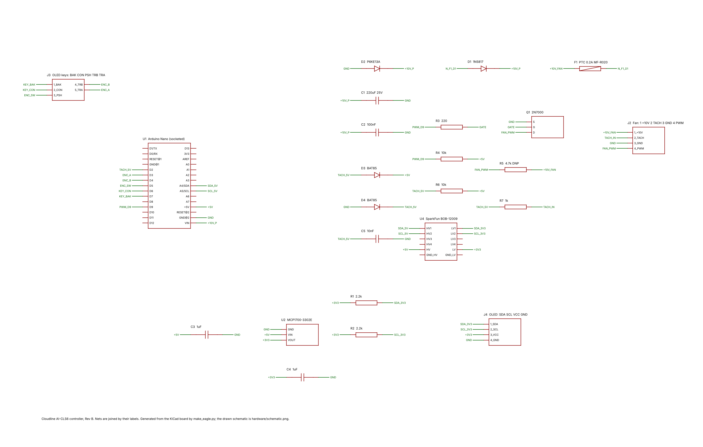

# Editable design for Fusion Electronics (EAGLE format)

Fusion 360's electronics workspace reads EAGLE 9 files. These two files are
the KiCad board in that format. Opened together, they become a linked
schematic and PCB that you can edit.

| File | What it is |
|---|---|
| [`cloudline_controller.sch`](cloudline_controller.sch) | Schematic: all 24 parts and 20 nets, joined by net labels |
| [`cloudline_controller.brd`](cloudline_controller.brd) | Board: 100 × 75 mm outline, 4 M3 holes, every part at its KiCad position, all 100 track segments on **Bottom (16)**, silkscreen, design rules |
| [`schematic_preview.png`](schematic_preview.png) | What the schematic sheet looks like |
| [`make_eagle.py`](make_eagle.py) | Generates the two files from `../cloudline_controller.kicad_pcb` |
| [`check_eagle.py`](check_eagle.py) | Checks them (see below) |
| [`eagle.dtd`](eagle.dtd) | EAGLE 9.1.3 file-format DTD from Autodesk (CC BY-ND 3.0, unmodified), used by the check |
| [`preview_schematic.py`](preview_schematic.py) | Draws `schematic_preview.png` |

Both files embed the library **cloudline**:

- the packages are made from the KiCad footprints, with the enlarged
  single-sided pads;
- each part has its own symbol and device;

so no other library is needed.

## Opening in Fusion 360

1. In the **Data Panel**, choose *Upload* and select **both**
   `cloudline_controller.sch` and `cloudline_controller.brd` in one go.
   Fusion converts EAGLE files into an electronics design. Uploading the pair
   together keeps the schematic and the board linked, so changes are kept in
   sync between them.
2. Open the design and run **ERC** on the schematic and **DRC** on the board.
   The board carries the rule set `cloudline_single_sided`:
   - 0.6 mm clearance;
   - 0.4 mm minimum track width;
   - 0.8 mm copper to edge;
   - two net classes, *default* (0.5 mm tracks) and *power* (0.8 mm tracks).

## Things to know when editing

- **Single-sided.** Route only on the **Bottom** layer. In EAGLE and Fusion,
  a through-hole pad always has copper on Top and Bottom, so the 3D PCB shows
  a ring on the top side too. On the milled or etched board that ring does not
  exist. Only Bottom copper is cut.
- **Schematic style.** The parts are connected by **net labels** (a short
  stub with the net name on each pin), not by drawn wires. Pins with the same
  label are the same net. The drawn circuit diagram with explanations is
  [`../../schematic.png`](../../schematic.png).
- **Pad shapes.**
  - EAGLE pads are round or square. Pads that were round or square in KiCad
    keep the same shape and size.
  - The 12 slightly oval BOB-12009 pads (1.9 × 2.0 mm) become round
    1.9 mm pads.
  - Restring settings never make a pad smaller than its package size.
- **Which copy is master.** This repository's master copy is the KiCad project.
  The milling files in [`../fusion/`](../fusion/README.md) and the Gerbers in
  [`../fab/`](../fab/) are made from it. If you change the board in Fusion,
  those files no longer match. Machine the edited board from Fusion itself
  (its 3D PCB, or a Gerber/CAM export of the Bottom layer).

## How the files are checked

`python3 hardware/pcb/eagle/check_eagle.py` (KiCad 7 and lxml needed):

1. **Both files are valid** against EAGLE's DTD.
2. **The board is read back with KiCad's own EAGLE importer**, independent
   of the code that wrote it. The check then confirms:
   - all 95 pads are at the same position as on the KiCad board (worst error
     0.0000 mm), with the same size, drill and net;
   - the 100 track segments are identical;
   - KiCad finds 0 unconnected items;
   - `../check_pcb.py`, which checks the copper against PINOUT.md, passes on
     the imported board: 20 nets, 71 pads, 0 problems.
3. **The schematic is checked geometrically:**
   - every net stub starts exactly on its pin's real position, on the
     0.1 inch grid;
   - every label sits on its stub;
   - no two pins share a point;
   - the device pin-to-pad maps give exactly the board's netlist.

A mutation test (rotating one part, re-pinning one net) made the check fail as
expected. What has **not** been tested is opening the files in Fusion 360
itself. Fusion isn't available here.
