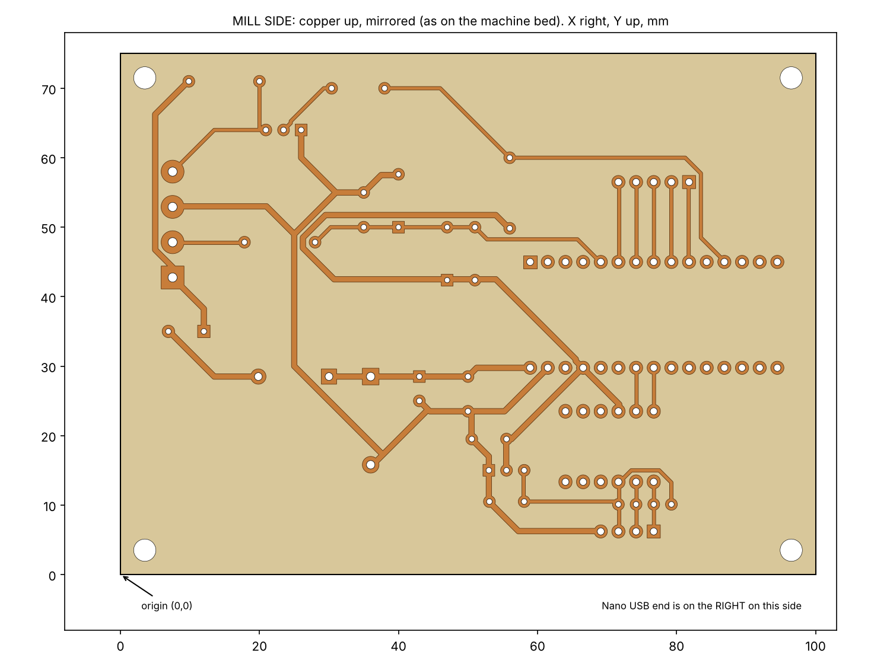

# Milling the PCB with Fusion 360 on a Stepcraft M.1000

These files let you mill the single-sided board from a copper-clad blank. They
come from the same KiCad design as the Gerbers in [`../fab/`](../fab/). CAM is
done in Fusion 360's **Manufacture** workspace, and the machine is a Stepcraft M.1000.

> **Tool and machine values below are starting assumptions.** They are marked
> ⚠. The open questions at the end list what has to be confirmed before this
> is turn-key.



## Files

| File | Use |
|---|---|
| [`cloudline_pcb_MILL_copper_up.step`](cloudline_pcb_MILL_copper_up.step) | **The model to machine.** Board flipped copper side up, the way it lies on the machine bed. The FR-4 body (`FR4_substrate`, with all 99 holes) and one 0.035 mm copper body per net (`copper_<net>`). Origin is the board's lower-left corner; Z = 0 is the underside of the board; the copper top is at Z = 1.635 mm. |
| [`cloudline_pcb_MILL_copper_up.dxf`](cloudline_pcb_MILL_copper_up.dxf) | The same view in 2D, mm, same origin. Layers: `OUTLINE`, `COPPER` (pad and track outlines), `ISO_PASS1` and `ISO_PASS2` (ready-made isolation tool-centre paths), `DRILL_0p75mm` … `DRILL_3p20mm` (one layer per hole size), `FIDUCIAL` (corner marks). |
| [`cloudline_pcb_TOPVIEW.step`](cloudline_pcb_TOPVIEW.step) | The board as seen from the component side (copper underneath). Use it to check the design or to fit it into an enclosure model. **Do not machine it.** |
| [`milling_report.txt`](milling_report.txt) | Smallest copper gaps, a cut-width table for V-bits, hole sizes and counts, isolation path lengths. |
| [`isolation_preview.png`](isolation_preview.png) | The isolation paths over the copper. |
| [`make_fusion.py`](make_fusion.py), [`check_fusion.py`](check_fusion.py) | Generate and check the files above. |

**Why the files are mirrored.** KiCad draws the bottom copper as seen through
the board from the top. On the machine you look at the copper directly, so
the `MILL` files are rotated 180° about the board's long axis. In the plane,
x′ = 100 − x and y′ = 75 − y. The `FIDUCIAL` layer and the Nano's USB end
(on the right of the mill files) help you check the orientation.

## Design numbers that matter for milling

- Board: 100 × 75 mm, 1.6 mm FR-4, copper on one side only.
- **Smallest copper-to-copper gap: 0.41 mm.** Twelve net pairs are under 0.5 mm.
  Every isolation cut must fit inside these gaps.
- Copper to board edge: at least 3.15 mm. The outline cut never touches copper.
- Holes: 0.75 mm ×4, 0.80 ×32, 1.00 ×51, 1.10 ×2, 1.20 ×2, 1.30 ×4, 3.20 ×4
  (mounting). That is 99 in total, all non-plated.
- The pre-computed isolation paths assume ⚠ a **30° V-bit, 0.1 mm tip, cut
  0.10 mm deep**, which gives a 0.154 mm wide cut. There are two passes, at
  0.077 mm and 0.169 mm from the copper. That clears about 0.25 mm around
  every track and pad, so soldering is easier and stray copper slivers are
  less likely. The script simulates the cut and confirms two things: every
  net ends up separated from every other, and no copper of any net is removed.

## Fusion 360 setup

### 1. Import

1. **Upload** `cloudline_pcb_MILL_copper_up.step` into a project and open it.
   Units are mm. Check that the board's corner is at the origin.
2. Create an **offset plane** 1.635 mm above the XY plane. Insert
   `cloudline_pcb_MILL_copper_up.dxf` onto it with **Insert → Insert DXF**.
   Use origin 0,0 and mm units. You can select only the layers you need.
   The DXF lines now sit on the copper surface, right above the matching
   model edges.

### 2. Manufacture → Setup

- **Operation type:** Milling.
- **WCS:** Orientation *Model orientation*, so Z points up out of the copper.
  Origin *Stock box point*, at the **top lower-left** corner.
- **Model:** the whole STEP body set.
- **Stock:** *Fixed size box* or *Relative size box*. The side offsets are the
  spare copper around the board on your blank ⚠ (e.g. 5 mm). Top offset is 0.
  The stock height is the blank thickness (1.6 mm, or 1.635 mm with copper).
- **On the machine:**
  - X/Y zero is the point on the blank that matches the WCS origin.
  - Z zero is the copper surface. Probe it with a touch plate on the copper,
    or touch off with a paper strip.
  - A 100 × 160 mm Eurocard blank fits this board with margin in either
    orientation.

### 3. Operations

Make one operation per tool. They run in this order: isolation, then drilling, then outline.

**Op 1: Isolation (2D → Trace)**

- Tool ⚠: engraving or V-bit, 30°, 0.1 mm tip. Create it in the tool library
  as a *chamfer mill* or *engrave* tool with the real angle and tip diameter.
- Geometry: chain-select all curves on layer `ISO_PASS1`. For the wider
  clearance, add a second Trace for `ISO_PASS2` (recommended).
- Heights: *Bottom height*, *Selected contour(s)*, *Offset −0.10 mm*.
  The curves are at the copper top, and Z = 0 at the copper top, so this
  cuts 0.10 mm into the copper and the substrate.
- Check: simulate with stock and compare the result with
  [`isolation_preview.png`](isolation_preview.png).

*Alternative if you use a different tool or depth:* use a 2D Contour on the
top faces of the `copper_*` bodies with *compensation: in computer*, so
Fusion computes the offsets itself. Or change the tool constants in
`make_fusion.py` and regenerate (see below). Do **not** cut deeper with the
supplied paths: at 0.15 mm the 30° bit is 0.18 mm wide and would bite about
0.01 mm into the pad edges.

**Op 2: Drilling (Drilling → Drill)**

- Geometry: *Selected faces*. Click one hole wall of each size and use
  *Select same diameter*. Make one Drill operation per tool ⚠.
- Suggested bit set (carbide PCB drills):

  | Holes | Drill with |
  |---|---|
  | 0.75 mm ×4, 0.80 mm ×32 | 0.8 mm |
  | 1.00 mm ×51 | 1.0 mm |
  | 1.10 mm ×2, 1.20 mm ×2 | 1.2 mm |
  | 1.30 mm ×4 | 1.3 mm (or bore with the 0.8 mm end mill) |
  | 3.20 mm ×4 (mounting) | 3.2 mm, or *2D Bore* / *Circular* with the outline end mill |

- Cycle: *Chip breaking – partial retract*, peck about 0.5 mm.
  Set *Drill tip through bottom*, with a break-through depth of about 0.3 mm.
  The spoilboard must be sacrificial.

**Op 3: Outline (2D → 2D Contour)**

- Tool ⚠: 2 mm two-flute end mill (1.5–3 mm all work).
- Geometry: the outer bottom edge of `FR4_substrate`. Tool on the outside.
- *Multiple depths*, max step-down ⚠ 0.5 mm. Bottom height 0.2 mm below the
  stock bottom.
- *Tabs*: 4 × 3 mm wide, 0.6 mm thick. Alternatively, cut the full depth if
  the board is held down with tape across its whole area.

### Starting feeds and speeds ⚠

These are typical values for a Stepcraft with a 20 000+ rpm spindle and
carbide tools. Run a test on scrap first.

| Tool | rpm | Feed | Plunge | Step-down |
|---|---|---|---|---|
| 30° V-bit 0.1 mm | 20 000–24 000 | 300 mm/min | 60 mm/min | single pass, 0.10 mm |
| 0.8–1.3 mm drill | 20 000+ | — | 60–100 mm/min | peck 0.5 mm |
| 2 mm end mill | 18 000–22 000 | 400–600 mm/min | 100 mm/min | 0.5 mm |

### 4. Post-processing

- Use the post that matches your control software. In the Fusion post
  library, search for **UCCNC** or **WinPC-NC** (both are used with Stepcraft
  machines). If it is a different controller, use its post.
- **Fusion Personal (free) licence:** each program can only use one tool and
  rapid moves are output as feed moves. Post each operation (each tool) on its own, and re-zero Z after
  each tool change. Zero Z on the copper, not on the spoilboard.

## Workholding and flatness

Isolation depth is 0.1 mm, so the blank must be flat to within about
±0.05 mm. Otherwise traces get cut through in one place and not isolated in another.

1. **Surface the spoilboard** where the board will go. Use a large flat end
   mill, cut about 0.2 mm deep.
2. Stick the blank down with **thin double-sided tape** over its whole area,
   and press it flat. Tape only at the edges lets the middle bow up.
3. Zero Z on the copper near the centre of the board.
4. If your control software supports **height mapping (auto-levelling)**, use
   it. It makes the 0.1 mm depth reliable even on a slightly warped blank.

## After milling

- Scrub the copper with a fine abrasive pad and check every gap against the
  copper preview with a loupe. A continuity tester across the narrow pairs in
  `milling_report.txt` catches leftover slivers.
- A milled board has no solder mask and no silkscreen. Print
  [`../fab/assembly_top.pdf`](../fab/assembly_top.pdf) at 100 % as the
  placement guide. A coat of solder-through flux lacquer protects the copper.
- Assemble as in [`../README.md`](../README.md). Parts go on the side
  **without** copper.

## Regenerating

```sh
pip install shapely ezdxf build123d matplotlib
python3 hardware/pcb/fusion/make_fusion.py    # STEP, DXF, previews, report
python3 hardware/pcb/fusion/check_fusion.py   # re-reads the STEP files and checks them
```

`make_fusion.py` reads `../cloudline_controller.kicad_pcb`. It needs no KiCad
install. To change the isolation tool, edit `VBIT_ANGLE`, `VBIT_TIP`,
`CUT_DEPTH`, `N_PASSES` and `PASS_OVERLAP` at the top of the script. The
script stops with an error in either of these cases:

- the isolation cut can't fit between two nets;
- the simulated cut would join nets or remove copper.

`check_fusion.py` verifies these things in both STEP files:

- 45 valid solids;
- the substrate size, position and hole volume;
- one copper body per net, with copper volume within 0.5 % of the 2D design;
- Z placement;
- a reference pad in the right place in both orientations.

## Open questions (to make this turn-key)

Each answer replaces a ⚠ above with your real setup:

1. **Control software** on the M.1000 (UCCNC, WinPC-NC, other)? It decides the post-processor.
2. **Spindle**: which one, and its rpm range?
3. **Fusion licence**: Personal (free) or commercial? Personal limits each program to one tool.
4. **Blank**: size, FR-4 or FR-1/FR-2, thickness, copper weight (35 or 70 µm)?
5. **Isolation tool**: V-bit angle and tip, or a flat end mill (diameter)?
6. **Drills** you have, and the **outline end mill** diameter.
7. **Workholding** and **Z probe / height mapping**: tape, clamps or vacuum? Touch plate? Auto-levelling?
8. Do you want the design **editable in Fusion Electronics**, or are STEP and DXF enough?
9. Should the board be **re-routed with wider gaps** (for example ≥ 0.6 mm) for more forgiving milling?
